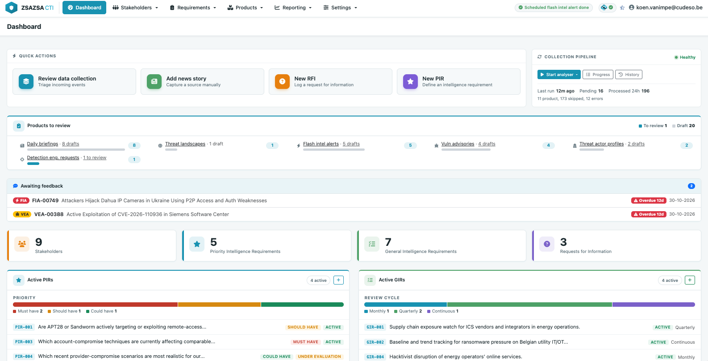
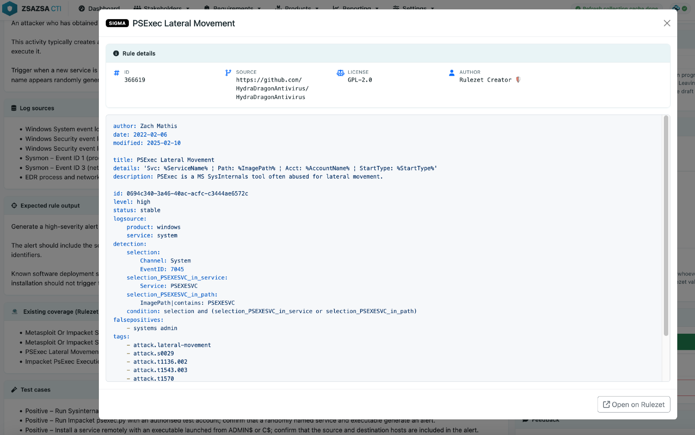
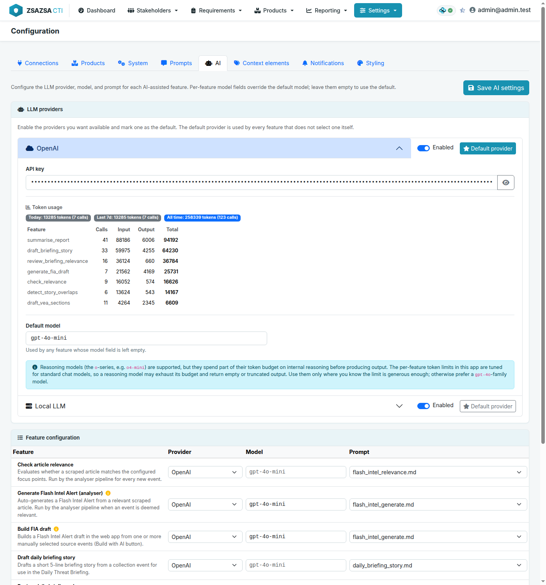

# zsazsa CTI

<p align="center">
  <a href="https://zsazsa-project.org/documentation.html"></a>
  <a href="INSTALL.md"></a>
  <a href="docker/README.md"></a>
  <a href="#configuration"></a>
  <a href="CHANGELOG.md"></a>
  <a href="https://zsazsa-project.org"></a>
</p>

zsazsa is a **CTI program** management and production platform built around [MISP](https://www.misp-project.org/). It links collection, triage, analyst workflows, requirement management, publishing and stakeholder delivery in one place, for teams that want to run threat intelligence as an operational capability rather than as loose documents and disconnected scripts.

To set zsazsa up, follow the [quickstart](https://zsazsa-project.org/documentation.html): install it with Docker or next to MISP, configure it with the setup wizard, and publish a first briefing. [INSTALL.md](INSTALL.md) has the installation in full. If you are upgrading, read [CHANGELOG.md](CHANGELOG.md) first.

This README has two parts. The first describes what zsazsa does and how analysts work with it. The second, the [reference](#reference), has the details.

**Using zsazsa:** [Intelligence flow](#intelligence-flow) · [Intelligence products](#intelligence-products) · [Reviewing and publishing](#reviewing-and-publishing) · [Distribution](#notification-and-distribution-flow) · [What the analyser does](#what-the-analyser-does) · [Newsletters](#importing-newsletters)

**Reference:** [The analyser in detail](#the-analyser-in-detail) · [Indicator feed URLs and caching](#indicator-feed-urls-and-caching) · [Newsletter import in detail](#newsletter-import-in-detail) · [Configuration](#configuration) · [MISP model](#misp-model-and-tagging-approach)

zsazsa is developed with the support of AI.

## Overview


## Intelligence flow

zsazsa follows the daily CTI workflow, from collection through triage and analysis to publishing and feedback. The main areas are:

- **Dashboard**: active PIRs and GIRs, stakeholders, analyser status and products waiting for review.
- **Stakeholders**: who receives your output, with role, organisation, TLP, product subscriptions and notification channels.
- **Requirements (PIR and GIR)**: the intelligence questions that drive collection, with their scope, ownership and distribution.
- **RFIs**: one-off requests from intake to closure, with an SLA, an owner and a linked PIR or GIR.
- **Data collection**: the cached view of every source, where you triage events, enrich them, summarise them with AI and start a product.
- **The analyser**: reads what you collected and drafts the daily threat briefing, flash intel alerts and vulnerability advisories for an analyst to review.
- **Products**: flash intel alerts, vulnerability advisories, daily threat briefings, threat landscape reports, indicator feeds, threat actor profiles and detection engineering requests.
- **Statistics**: pipeline and program metrics, scope coverage, and a CTI-CMM maturity panel.
- **Background jobs** and the **Pipeline** page: what is running, and afterwards what became of each event.


### Audit trail in MISP

zsazsa keeps its data in MISP as events, objects, attributes and event reports, so teams can review the raw records directly in MISP. The MISP **event history** is an audit trail of every change to a product, stakeholder or requirement.

### Dashboard

The dashboard gives an **operational overview**: pipeline state, active requirements, stakeholders and recent analyser results. **Products to review** shows, per product type, how many wait for a review or are drafts.



### Stakeholders

A stakeholder is linked to an organisation and has an internal or external role, contact details, a TLP clearance, product subscriptions and delivery preferences. Stakeholders own PIRs and GIRs or are in their distribution, and the list can be exported as Markdown.


On the **stakeholder matrix** you record each stakeholder's power over your CTI program and their interest in its output. 


### Requirements

#### PIR

A PIR holds the intelligence question, the decision it supports, its intelligence level, priority and sub-questions. Give it scope items, such as a geography, sector, threat actor, technique, vendor and product, or a campaign, and data collection **highlights the events that match**.


**Triage** acknowledges, approves, defers, rejects or merges a submitted PIR.


The PIR detail page combines scope, sub-questions, ownership, distribution and collection mapping.


#### GIR

A GIR records intelligence needs over longer cycles, with a review cadence, scope and expected outputs. A PIR can be linked to the GIRs it falls under.


#### RFI

An RFI goes from intake to closure with a priority, SLA, owner, linked requirement and response tracking. Its detail page holds notes, attachments and the requester's feedback.


### Data collection

Data collection is the **central place for the daily work**: a cached view of every source you set up, the MISP scraper, other MISP servers, and the manual and newsletter sources, with filters for source, tags and context.


**CTI evaluation** scores an event's relevance and confidence during triage.


An event you do not want to see again is **set aside**. On your own MISP it is rejected (`workflow:state="rejected"`); an event from another MISP server is dismissed with the local tag `zsazsa:event="dismiss"`.

An analyst can **enrich an event** with scope from the [MISP galaxies](https://misp-galaxy.org/): geography, sector, threat actor and techniques.


When something relevant did not come in through a source, an analyst adds the article by hand. Its AI summary ticks the scope items it names.


Articles can also come from a security newsletter, pasted in or read from a mailbox (see [Importing newsletters](#importing-newsletters)).


### Intelligence products

From the same view, analysts **create a product** from selected source events.


#### Daily threat briefing

The **daily threat briefing** collects the day's stories, one per source event, with a summary of the day.


#### Vulnerability advisory

A **vulnerability advisory** describes a CVE for the teams that have to patch, with evidence and indicators from the source events.


#### Flash intel alert

A **flash intel alert** is a short warning about one event that needs attention within the day.


#### Threat actor profile

A **threat actor profile** starts from what the MISP galaxies hold about the actor, which you expand with your own findings.


Each profile builds a **Diamond Model** view of the actor across adversary, infrastructure, capability and victim.


The infrastructure you observed goes in an indicator feed, and a profile can embed one or more of them.


#### Detection engineering request

When collection turns up a threat you have no detection for, a **detection engineering request** asks the detection engineers to write one: the hypothesis, the technique, the log sources, what a hit looks like and how to test it. Detections you already have, found through Rulezet, go in as existing coverage.

**Approve first** on the status board opens a request for review and approval without leaving the list. After that it moves along an engineering board: Pending, In Dev, In Test, Active, Retired. Marking it **Active** needs a draft rule that passes Rulezet's validator.



### Reviewing and publishing

Products start as drafts or submitted for review so a colleague looks at it first.

On the briefing, alert, advisory and threat actor profile lists, **Preview and approve** opens a draft inline, with **Approve & publish** beside **Recipients**, which shows who will receive the product and why the others will not. Approving takes MISP's publish permission. For alerts and advisories, **QA check against source** has the AI check the draft against its source events and list the claims to fix. Keep the page open for its result.

Reject a draft you do not want, with a reason if you like, rather than delete it: the analyser reads a deleted product's source events again, so a deleted draft can come back. On the alert, advisory and briefing lists, drafts can be approved, rejected or deleted together, and each list can delete all its rejected products at once. The "How ... is made" line under each list's filters shows every step from collection to delivery, and who does it.

### Indicator feed

An indicator feed is a saved MISP query that returns the matching indicators. You build the query on the feed's page, where `+` and `-` buttons beside the results add an event or an organisation, and **Run search** refreshes the results without saving.


The page shows the feed as a PyMISP query, to copy and reuse elsewhere.


Each feed also has its own **unique URL**, which a tool pulls without a login, as a list of unique values, CSV, a tab-separated list or JSON. Build a feed for your SOC, perhaps tied to a threat actor profile, send it through the notification channels, and their tooling pulls it from then on. [Indicator feed URLs and caching](#indicator-feed-urls-and-caching) has the formats, the URL parameters, a standalone PyMISP script and caching.

### Statistics

The statistics pages combine operational metrics with CTI maturity.


The scope statistics count how often each scope value is used across PIRs, GIRs, threat actor profiles and briefings.

### AI support

zsazsa works with **OpenAI** and with a **local LLM** behind an OpenAI-compatible API, such as [Ollama](https://ollama.com/). Each AI feature chooses its own provider, model, temperature and prompt on the AI tab. The features send raw MISP event text to the provider, so a local model keeps that content in-house.



The AI summarises reports, judges relevance for the analyser, writes briefing stories, drafts threat actor profiles, threat landscape reports and advisories, and checks alerts and advisories against their sources. MISP's [ai-connector](https://github.com/cudeso/ai-connector) module can summarise events on another MISP server. See [AI](#ai) under Configuration.

### Detection rules from Rulezet

[Rulezet](https://rulezet.org) is a community repository of public detection rules in Sigma, YARA, Suricata, Elastic and other formats. The briefing, alert, advisory, threat actor profile and detection engineering request forms have **Search Rulezet**, which finds rules for the CVEs or ATT&CK techniques on the product and shows them syntax highlighted. A product keeps the rule's name and link, not a copy, with a button to view it again.

### Background jobs and the Pipeline page

Longer work runs in the background: analyser runs, AI summaries, deliveries and mailbox polls. A **badge in the top bar** shows what is running, scheduled runs included, and a job that stops reporting for half an hour is shown as stalled. The job state is kept in Redis.

The **Pipeline** page has a tab per question.

### Collection source management

The Collection sources page manages every **data collection source** in one place: the scraper, other MISP servers, manual sources and mailboxes.


## Notification and distribution flow

Distribution is built around stakeholders, roles, product subscriptions, audiences and **notification channels**. A stakeholder has one role (SOC, Incident Response, Cyber Threat Intelligence and so on), subscribes to product types and chooses the channels they receive products on. A product has one or more audiences, each a stakeholder role.

When a product is published, a stakeholder receives it only **when their role is in the audience*, they subscribe to that product type, and their TLP clearance covers the product's TLP. It then goes out over their channels.

A channel can take every product or only some product types. [Flowintel](https://flowintel.org/) is restricted: a case is created only for the products enabled for that instance in its `case_templates`.

## What the analyser does

The analyser does the first part of the day for you. It reads what you collected, picks out what concerns you and drafts three products: the **daily threat briefing**, **flash intel alerts** and **vulnerability advisories**. You review the drafts and decide what goes out.

You start it from the dashboard with **Start analyser**, which has an option per product. The scheduled analyser, `run_analyser.py`, does the same every hour from cron or in its own Docker container. By default it only makes flash intel alerts. The advisories and the briefing are switched on under Settings > Analyser.

### How it decides

Each run reads what came in or changed since the previous one: the scraper's events, the manual entries that have a report, and the events of the other MISP servers whose "Analyse its events" is on. An event without an AI summary gets one first. An event whose article could not be fetched is rejected.

For the alerts and the briefing, one AI call per event reads the article against your focus points and your active PIRs and GIRs. It says whether the event is worth an alert (it needs attention within the day), a briefing story, both or neither, and quotes the article for each match. It also scores the article on the `cti-evaluation` taxonomy and reads its date: by default an alert needs an article at most three days old, and a story one at most a week.

Before an alert or a story is made, the event is compared with the alerts and stories of the last 30 days. A story told before is left out, and one that adds facts becomes an update of the earlier product.

The vulnerability advisories go by CVE. A CVE gets an advisory when it concerns you, because its product is in the asset database or its vendor or product is in your focus points or an active requirement, and when no advisory of the last 90 days covers it.

An event that every product declined is rejected, with the reasons in a report on the event. An event flagged for follow-up never is.

### What you get

The **daily briefing** is one draft a day with at most 15 (configurable) stories. The others are listed under **Also seen** on the draft, from where you can add one back. A **flash intel alert** is for the stakeholders of every PIR and GIR behind it, or for everyone who can receive it when only focus points matched. A **vulnerability advisory** covers the CVEs of one event. No draft has a lower TLP than its source events.

Every draft says why it exists: the alert and advisory lists show the requirement, focus point or CVE that matched under the title.

### Correcting it

| What you see | What to do |
|---|---|
| A draft you do not want | **Reject** it. Do not delete it: the next run reads a deleted product's events again |
| A story in a briefing you do not want | Delete it from the briefing. Saving the briefing rejects its event, so it does not come back |
| A good story that did not make the briefing | Add it from **Also seen** |
| An event the analyser declined, and you disagree | **Push** it in the Pipeline activity, for a story or for an alert and a story. The next run makes the product |
| An event you want to look at yourself | **Review by hand** in the Pipeline activity. It is flagged for follow-up and back on Data collection |
| You changed a focus point, a requirement or a prompt | **Read again the last (hours)** under Start analyser |

Your own relevance score on the data collection page works as Push does: **very high** sends an event to an alert and the briefing, **high** to the briefing, and **low** or lower keeps it out of both.

On the Pipeline page, *Analyser runs* has the decision and the reason for each event of a run. If you often push the same kind of event, a focus point is missing. If you often reject the same kind of draft, a focus point is too wide or a feed too noisy.

### Setting it up

Everything depends on your focus points and requirements. Enter the focus points under Settings > Products or in the setup wizard, and be specific: "IT" or "Energy" is too vague for a model to judge against. The analyser uses the active PIRs and GIRs. A "Must have" or "Should have" PIR can give an alert, a "Could have" one only a briefing story, and a "Won't have" one is not considered.

The analyser needs an AI provider on the AI tab. Settings > Analyser has the rest, and most of it can stay as it is. Start with the flash intel alerts, spend a week on the declined events and your focus points, then switch on the briefing and the advisories.

The text of another MISP server's events goes to the AI features whatever its TLP, and to a cloud provider where the AI tab uses one, so "Analyse its events" is off until you switch it on. Each event costs a model call: keep that server's filters narrow.

## Importing newsletters and mailboxes

Curated security newsletters can list dozens of articles per edition. Rather than copy them in one by one, open "Import from newsletter" on the Data collection page, choose the format, paste the e-mail and select "Parse and review". The importer lists each article with its links and the grading the newsletter gives it.

Two formats are supported. The **ETDA Cyber Threat Intelligence (CTI Robot)** digest grades its items, so its **critical** and **urgent** articles are pre-selected. **IT-ISAC Open Source News** does not, so you pick the articles yourself.

Each selected link goes to misp-scraper, which fetches the article and creates a MISP event. The newsletter itself is archived as a MISP event, with the e-mail as a report and the links attached.

zsazsa can also read newsletters from a mailbox. Add it under Collection sources > IMAP mailboxes, with one data collection source per newsletter, and `run_imap_collector.py` polls it every 15 minutes. In **automatic** mode a matched newsletter's links go to the scraper at once. In **manual review** mode it waits under "Email sources" on the Data collection page for an analyst to pick the articles; use it for a mailbox external senders can reach.

---

# Reference

## The analyser in detail

[What the analyser does](#what-the-analyser-does) has the overview, and [Analyser](#analyser) under Configuration has the settings.

### Reading the events

Each option reads what came in or changed since its previous completed run, scheduled or from the dashboard, on the sources switched on under Settings > Analyser:

- the scraper's events (`SCRAPER_MARKER_TAG`), at most `ANALYSER_MAX_EVENT_AGE_DAYS` old;
- the manual entries that have a report;
- the events with a report on each other MISP server whose "Analyse its events" is on, through that server's filters and at most its "Max events" a run.

The first run reads the last hour, or the last day for the briefing and the advisories. Another server is read over its "Events from last (days)" window every time, as a synced event keeps the timestamp it had elsewhere. An event already handled is read again only when its MISP timestamp changed. A source that cannot be reached is read again by the next run.

On zsazsa's own MISP only events in workflow state `incomplete` or `ongoing` are read. Another server's events are not zsazsa's to change: the analyser keeps its decisions about them in zsazsa, and adds at most an AI summary where "Allow adding reports to events" is on.

An event whose article could not be fetched, or whose report is empty, is rejected. Every other event gets an AI summary when it has none or the article is newer. A summary that fails leaves the event for the next run.

A draft starts at TLP:CLEAR for a briefing and TLP:AMBER for an alert or advisory, raised to the strictest TLP of its sources. A story added to a briefing later raises it in the same way. A lower TLP set on the form is your own decision.

### The relevance verdict

One AI call per event reads the article, its title and its summary against your focus points and your active PIRs and GIRs (leaving out "Won't have"). It decides two things. An alert is for something that needs attention today. A briefing story is threat information that clearly concerns a focus point or answers a requirement, or, with `ANALYSER_MAJOR_DEVELOPMENTS` on, a major development every organisation should know about. A vendor's vulnerability notice with no reported exploitation is left to the advisories.

For each "yes", the AI names the focus points or requirements the article concerns and quotes the article as evidence. Evidence only counts when it names one of your own focus points or requirements and its quote, of at least four different words, appears in the article or its title. A quote shortened with "..." counts when its parts appear in that order, each at least two words long. A "yes" without evidence becomes a "no", unless the story is a major development.

The same call scores the article on `cti-evaluation` and reads its publication date, which sets its timeliness. An article without a known date is not treated as old.

The verdict is kept until your focus points, requirements, the prompt or the model change, or the event's title, date, summary or article does. When the answer cannot be read, the event is tried again, for at most `ANALYSER_RELEVANCE_ATTEMPTS` runs.

Your own `cti-evaluation` scores replace the model's, and your relevance score overrides the verdict. An event you push this way skips the limits and the briefing's cap, counts whatever its age, and is reopened if the analyser had rejected it.

### Earlier products

Before an alert or story is made, the event is compared with the alerts and briefing stories of the last `ANALYSER_SIMILARITY_DAYS` (30). Only those sharing a CVE, a threat actor or much of the title go to the AI for the comparison. The same story is left out and not proposed again. One that adds facts becomes an update naming the earlier product, unless that one was rejected. When the comparison fails, the product is made and says so.

### Making the daily briefing

1. It skips events with an excluded title (`DAILY_BRIEFING_TITLE_EXCLUSIONS`) and those already in a briefing or under Also seen.
2. It keeps the events the verdict wants: those you pushed first, then those worth an alert, then by PIR priority and score, with major developments last.
3. It drops repeats of the day or of an earlier briefing and keeps the first `ANALYSER_BRIEFING_MAX_STORIES` (15). The rest go under Also seen, which is not sent.
4. It drafts a story per event and a summary of the day. Later runs that day add to the draft.
5. It closes the events no product wants (see [Closing the events](#closing-the-events)).

### Making flash intel alerts

1. It skips events with an excluded title or with an alert already, even a rejected one.
2. It makes an alert of each event the verdict wants for one. A PIR alone only counts from `ANALYSER_ALERT_MIN_PRIORITY` ("Should have"); a focus point or GIR always does.
3. The AI drafts it with the Build with AI prompt. A failed draft is retried next run.
4. A stakeholder on automated mode, cleared for its TLP, gets it published and sent at once.
5. While the daily briefing is off, it closes the events no product wants.

### Making vulnerability advisories

This option goes by CVE, not by the verdict, and the title exclusions do not apply.

1. It takes up to `ANALYSER_ADVISORY_MAX_CVES` (10) CVEs from the event's vulnerability attributes, or else its title.
2. It skips a CVE named in any advisory of the last 90 days, unless it has since joined the CISA KEV list or its CVSS score rose by 1.0 or more. The new draft then names the earlier advisory. A rejected advisory keeps the CVE out regardless.
3. It keeps a CVE only when it concerns you: its product is in the asset database (if enabled), or its vendor or product is a vendor or technology focus point or in an active PIR or GIR. A CVE with no product yet is matched on title and summary, or passes marked as not checked. With nothing to match against, every CVE passes.
4. It drafts one advisory per event, enriched from the vulnerability database. If a CVE lookup fails, the event waits for the next run.

### Closing the events

The briefing's run, or the alerts' run while the briefing is off, rejects the events every product declined, with the reasons in a report on the event. An event stays open while it has a product, is flagged for follow-up, waits for its verdict, or has CVEs the advisories have not seen or would now take. An event on another MISP server is closed in zsazsa only.

### Scheduled runs

A scheduled run makes the advisories, then the alerts, and once a day, from `ANALYSER_DAILY_BRIEFING_HOUR` (UTC), the briefing. That briefing adds to a draft made from the dashboard the same day, and to nothing once the day's briefing is published. A source that could not be read, or an event left for later, keeps the day open for the next run.

One run goes at a time. The dashboard holds its Start buttons while one is going, a scheduled run that finds one going skips its hour, and a lock not refreshed for an hour is released. A run stops, rather than decide on part of them, when MISP cannot list the products or requirements in full.

## Indicator feed URLs and caching

### The feed URL

A feed's URL starts switched on when a publisher creates the feed. The token is stored on the feed in MISP for your organisation only, so it does not sync. A feed never returns events tagged as a zsazsa record.

A feed comes in four formats, as a download on the page and as `format=` on the URL:

| Shape | What it holds |
|---|---|
| Values | One unique value per line. The default. |
| Type + value (`tsv`) | `type`, a tab, then the value. |
| CSV | One line per matching attribute, with its event and server, so a value can appear several times. |
| JSON | The feed (id, name, TLP), when the query ran, the count, and every indicator with its event context and tags. |

The query's limit sizes the table and the downloads. `truncate=off` returns everything that matches, up to 10000.

```
https://zsazsa.example.org/products/indicator-feed/public/<token>
https://zsazsa.example.org/products/indicator-feed/public/<token>?format=csv&truncate=off
```

### Caching

A feed that is pulled often can be cached: switch **Caching** on and pick hourly, daily or weekly. The result is written in all four formats under `data/feed_cache` and served from there until the interval passes, on the clock of the moment you saved the feed, so feeds do not all come due at once. The analyser run refreshes the feeds that are due, and the first request refreshes one that went stale between runs.

When a refresh cannot reach MISP, the feed serves the copy it has rather than an empty answer, and the feed page says the refresh failed. The results table on a cached feed is marked **live**, as it always queries MISP. Saving a feed drops its cache, and `truncate=off` always runs the query.

## Newsletter import in detail

### Handing articles to the scraper

zsazsa publishes one JSON message per selected article on a Redis channel that the scraper's `subscribe` service listens to, with the link, the title, the newsletter name as feed title, and `feed_tags` the scraper sets as local tags. The connection is on the "Manual sources pushing to scraper" card, and is separate from the Redis of MISP's sessions and of the background jobs.

### Mailboxes

A mailbox under Collection sources > IMAP mailboxes holds the connection, and one data collection source per newsletter, each with a parser, match criteria, a reliability rating and a mode. A message goes to the first source whose subject or sender matches; the sender match also reads the original `From:` line of a forwarded message. Events are attributed to `scraper:data-collection-source:<name>`.

If an automatic push finds no scraper listening, the edition goes to the review queue rather than being lost. Docker's `imap-collector` container polls every 15 minutes; a standard installation uses cron:

```
*/15 * * * * cd /var/www/MISP/misp-custom/zsazsa && venv/bin/python run_imap_collector.py
```

The Pipeline page shows each mailbox's last poll. A processed message gets the IMAP keyword `zsazsaProcessed`, which prevents processing it again, and nothing is deleted from the mailbox.

### Example: adding IT-ISAC Open Source News to an existing mailbox

Open the mailbox under **IMAP mailboxes**, select **Add source** and fill it in:

| Field | Value |
|---|---|
| Name | `IT-ISAC` |
| Parser | `IT-ISAC Open Source News` |
| Mode | `Automatic`, or `Manual review` to pick the articles yourself |
| Match subjects | `[IT-ISAC]` |
| Match senders | leave empty |
| Reliability | your own assessment, for example `B` |

Press **Save** on the source itself, not only on the mailbox.

Match on the subject here. IT-ISAC sends through FIRST's `first-news` list, so `From` is `first-news@lists.first.org` and `it-isac.org` is only in `Reply-To`, which the match does not read. `lists.first.org` would catch every other message from that list too.

## Configuration

Almost all settings are in `config/__init__.py` (`docker/volumes/config/__init__.py` in Docker). Most are changed under Settings: the Configuration page with the tabs below, Collection sources for the [data collection sources](#data-collection-sources), and the setup wizard. A save rewrites the whole file from a template, after a backup to `config/__init__.py.backup`, so a line added by hand that the template does not know is dropped. Restart zsazsa after editing the file by hand.

The settings pages are for MISP site admins (`perm_site_admin`) and hidden from everyone else. Without single sign-on everyone works as the same identity and the pages are open to all. Each tab but Prompts opens with an overview and a menu of its sections, and the address bar follows the tab.

Saved keys and passwords are never shown again. Leave the field empty to keep one, or tick "Remove" where a secret is optional. A secret stays with the address it was entered for: change a URL or host, and enter its key or password again.

### Connections

This tab has the MISP server zsazsa stores its records on, Rulezet and the asset database.

The **asset database** is a CSV file of `"Supplier","Product","Version"` rows (under `volumes/data` with Docker). A CVE whose supplier and product are in the file is in scope for an advisory, which names the asset under "Our exposure". Names are compared loosely: case, punctuation and "Inc." are ignored, "PAN-OS" is "PANOS", and initials match, so "HPE" is Hewlett Packard Enterprise. The version is not compared. A file that cannot be read fails the advisory run.

| Setting | Description |
|---|---|
| `MISP_WEBAPP_URL` | URL of the MISP server zsazsa stores its records on |
| `MISP_WEBAPP_KEY` | API key for that server. It needs no site admin; the page warns when its role lacks a permission zsazsa uses, or the key is read-only |
| `MISP_WEBAPP_VERIFYCERT` | Verify that server's TLS certificate (on) |
| `RULEZET_ENABLED` | Whether the Rulezet integration is on (on) |
| `RULEZET_URL` | Base URL of a [Rulezet](https://rulezet.org) instance, searched by CVE or ATT&CK technique and used to validate a detection request's draft rule. Empty disables it |
| `ASSET_INVENTORY_ENABLED` | Only make an advisory for a CVE in a product of the asset inventory |
| `ASSET_INVENTORY_FILE` | The asset inventory CSV file |
| `ASSET_INVENTORY_REFRESH_MINUTES` | How often the file is read again |

zsazsa checks a MISP certificate against the CA list of Python's requests package, not the host's. For a certificate from your own CA, keep verification on: add the CA to the host (on Debian or Ubuntu, copy it to `/usr/local/share/ca-certificates/` and run `sudo update-ca-certificates`), then set `REQUESTS_CA_BUNDLE=/etc/ssl/certs/ca-certificates.crt` for the web app (an `Environment=` line in the systemd unit) and in front of the analyser and IMAP collector cron entries. Turning verification off sends the API key to whatever answers at that address.

### Products

The six `FOCUS_POINTS_*` lists are what the relevance verdict judges each article against; the advisories use the vendors and technologies. The geographies, sectors, threat types and threat actors offer the names of their MISP galaxy and mark a name the galaxy does not have, as the AI then only knows the list it is on.

| Setting | Description |
|---|---|
| `PRODUCT_TYPES` | Catalogue of CTI product types offered when creating a product |
| `DAILY_BRIEFING_TITLE_EXCLUSIONS` | Titles or phrases of events left out of the daily briefing and the flash intel alerts |
| `FOCUS_POINTS_GEOGRAPHIES` | Geography focus points |
| `FOCUS_POINTS_SECTORS` | Sector focus points |
| `FOCUS_POINTS_VENDORS` | Vendor focus points |
| `FOCUS_POINTS_TECHNOLOGIES` | Technology focus points |
| `FOCUS_POINTS_THREAT_TYPES` | Threat type focus points |
| `FOCUS_POINTS_THREAT_ACTORS` | Threat actor focus points |
| `THREAT_ACTOR_TYPES` | Threat actor types and descriptions (ENISA taxonomy) |

Renaming a product type does not rename it in stakeholder subscriptions already stored in MISP. The System tab has a migration for the one rename that shipped with zsazsa.

### Analyser

The Analyser tab has the settings in the order the analyser works (see [The analyser in detail](#the-analyser-in-detail)). A change applies from the next run, without a restart. 

| Setting | Description | Default |
|---|---|---|
| `ANALYSER_FLASH_INTEL` | Make flash intel alerts on the scheduled runs | on |
| `ANALYSER_VULNERABILITY_ADVISORIES` | Make vulnerability advisories on the scheduled runs | off |
| `ANALYSER_DAILY_BRIEFING` | Make the daily briefing on the scheduled runs | off |
| `ANALYSER_DAILY_BRIEFING_HOUR` | Hour (UTC) from which the daily briefing is made | 21 |
| `ANALYSER_READ_SCRAPER` | Read the scraper's events | on |
| `ANALYSER_READ_MANUAL` | Read the manual entries | on |
| `ANALYSER_READ_MISP_SERVERS` | Read the other MISP servers whose "Analyse its events" is on. Each event read costs a model call | on |
| `ANALYSER_MAX_EVENT_AGE_DAYS` | Oldest scraper event read, in days, by its MISP date | 7 |
| `ANALYSER_LOOKBACK_HOURS` | How far back the alerts read a source the first time, in hours | 1 |
| `ANALYSER_BRIEFING_LOOKBACK_HOURS` | The same for the daily briefing and the advisories | 24 |
| `ANALYSER_MAJOR_DEVELOPMENTS` | A major threat development is a briefing story without a focus point or requirement behind it | on |
| `ANALYSER_ARTICLE_CHARS` | How much of the article the relevance call reads | 12000 |
| `ANALYSER_RELEVANCE_ATTEMPTS` | Runs that try an unreadable answer again before the event is left to the analyst | 3 |
| `ANALYSER_PULL` | An analyst's relevance score at or below this keeps the event out of the alerts and the briefing | low |
| `ANALYSER_PUSH_BRIEFING` | An analyst's relevance score at or above this pushes the event to the briefing | high |
| `ANALYSER_PUSH_ALERT` | An analyst's relevance score at or above this pushes the event to an alert | very-high |
| `ANALYSER_VERY_HIGH_TIMELINESS_DAYS`, `ANALYSER_HIGH_TIMELINESS_DAYS`, `ANALYSER_MODERATE_TIMELINESS_DAYS`, `ANALYSER_LOW_TIMELINESS_DAYS` | Age in days up to which an article's timeliness is very high, high, moderate and low. Older is very low | 1, 3, 7, 30 |
| `ANALYSER_WEIGHT_USEFULNESS`, `ANALYSER_WEIGHT_SPECIFICITY`, `ANALYSER_WEIGHT_TIMELINESS` | Weights of the three in the overall score | 1 each |
| `ANALYSER_ALERT_MIN_PRIORITY` | Lowest priority of a PIR that gives an alert on its own | Should have |
| `ANALYSER_ALERT_MIN_TIMELINESS`, `ANALYSER_ALERT_MIN_USEFULNESS`, `ANALYSER_ALERT_MIN_SPECIFICITY`, `ANALYSER_ALERT_MIN_OVERALL` | Lowest scores for an alert. Empty is not checked | high, then empty |
| `ANALYSER_BRIEFING_MAX_STORIES` | Most stories in a briefing. The rest are listed under Also seen | 15 |
| `ANALYSER_OVERLAP_SCORE` | Of two stories of one briefing this alike, the later one is dropped | 0.65 |
| `ANALYSER_BRIEFING_WITH_ALERTS` | An event with an alert can also be a story | on |
| `ANALYSER_BRIEFING_MIN_TIMELINESS`, `ANALYSER_BRIEFING_MIN_USEFULNESS`, `ANALYSER_BRIEFING_MIN_SPECIFICITY`, `ANALYSER_BRIEFING_MIN_OVERALL` | Lowest scores for a briefing story. Empty is not checked | moderate, then empty |
| `ANALYSER_ADVISORY_DAYS` | Days an advisory, in any state, keeps its CVEs from another | 90 |
| `ANALYSER_ADVISORY_MAX_CVES` | CVEs looked up per event | 10 |
| `ANALYSER_ADVISORY_CVSS_FLOOR` | Lowest CVSS score that gets an advisory, 0 for any | 0.0 |
| `ANALYSER_ADVISORY_UPDATES` | A covered CVE now on the CISA KEV list, or whose CVSS score rose, gets an update | on |
| `ANALYSER_ADVISORY_CVSS_RISE` | The CVSS rise that counts | 1.0 |
| `ANALYSER_ADVISORY_REJECTED_BLOCKS` | A rejected advisory blocks updates | on |
| `ANALYSER_ADVISORY_KEV_ONLY` | Only CVEs on the CISA KEV list | off |
| `ANALYSER_SIMILARITY_DAYS` | Days of alerts and briefing stories, in any state, an event is compared with | 30 |
| `ANALYSER_SHORTLIST_OVERLAP` | Title word overlap that has the AI compare an earlier product, besides a shared CVE or threat actor | 0.35 |
| `ANALYSER_SAME_STORY_SCORE` | Score that counts as the same story | 0.65 |
| `ANALYSER_REJECTED_BLOCKS_UPDATES` | A rejected product blocks updates of its story | on |
| `EVENT_LOG_RETENTION_DAYS` | Days the rows of the `event_log` table are kept | 90 |
| `PIPELINE_RUN_LOG_RETENTION_DAYS` | Days the pipeline run history is kept | 90 |

### System

**MISP event distribution** sets the distribution of every event zsazsa creates. **Logging** sets the log level and how long the audit log under Reporting > Logs is kept; a product's delivery badge comes from the audit log and goes with it. **Web server** covers the built-in server. zsazsa listens on `0.0.0.0` unless `ZSAZSA_BIND` in its environment names another address, and `ZSAZSA_PORT` there replaces `PORT`; the Docker setup sets both. Restart after changing the port or TLS settings. **Single sign-on** has its own section below.

| Setting | Description |
|---|---|
| `MISP_EVENT_DISTRIBUTION` | Distribution of events zsazsa creates: 0 your organisation, 1 this community, 2 connected communities, 3 all communities |
| `AUDIT_LOG_RETENTION_DAYS` | Days the audit log is kept (365, 0 keeps it for good) |
| `LOG_LEVEL` | Logging verbosity |
| `HOSTNAME` | Hostname used to build links. It does not change the listener |
| `PORT` | Port the application listens on |
| `SSL_ENABLED` | Whether the built-in server uses TLS |
| `SSL_CERT` | Path to the TLS certificate file |
| `SSL_KEY` | Path to the TLS private key file |

**Migration** runs the one-off scripts that rewrite existing data in MISP, each as a dry run first. The page only sends a migration id, never a path.

| Script | What it does |
|---|---|
| `scripts/make_zsazsa_tags_local.py` | Attaches `zsazsa:` tags again as local tags, so they never sync |
| `scripts/rename_vea_subscription_product.py` | Renames "Vulnerability exploitation advisory" to "Vulnerability advisory" in stakeholder subscriptions |
| `scripts/backfill_product_source_log.py` | Records the source events of products made before source logging existed |
| `scripts/convert_url_attributes_to_link.py` | Retypes the external references of manual collection entries |
| `scripts/align_requirement_scope_focus_points.py` | Gives a PIR or GIR the scope items its scope lists imply, and the other way round |
| `scripts/restore_rfi_ids.py` | Puts back the id of an RFI that lost it when its feedback was saved before 1.0.0 |

#### Single sign-on against MISP

zsazsa has no user accounts of its own. It identifies the analyst from MISP's session cookie, `MISP-<instance uuid>`, which the browser only sends when zsazsa is served under the address of `MISP_WEBAPP_URL`. Enable single sign-on and save, and zsazsa asks MISP for its UUID and stores the cookie name in `MISP_SESSION_COOKIE_NAME`.

Three things have to match:

- **PHP keeps MISP's sessions in Redis**: `session.save_handler = redis` and `session.save_path = "tcp://localhost:6379"`, with `MISP_SESSION_REDIS_*` pointing at the same Redis.
- **The database**: `MISP_SESSION_REDIS_DB` is the one in `session.save_path`, `0` when it names none. It is not MISP's own `redis_database` (13 by default).
- **The cookie name**: an install that kept the CakePHP default sends `CAKEPHP`. Set `MISP_SESSION_COOKIE_NAME` by hand then.

When one of them is wrong, nobody is identified, which with the redirect on looks like a login loop. **Test single sign-on** tells them apart: the cookie name zsazsa expects, the cookies the browser sent, the Redis database, and whether a session was found.

A session lasts as long as MISP's `Session.timeout`. While you work in zsazsa, it asks MISP for `/users/view/me.json` with your session every five minutes, which extends it; background requests such as the job badge do not, so an idle tab does not keep a session alive. With `Session.autoRegenerate` on, zsazsa leaves that refresh to MISP's own pages.

With `MISP_SESSION_REDIRECT_TO_LOGIN` on, a visitor without a session is sent to MISP's login page; with it off, they work as `admin@admin.test`. Two URLs work without a session because they are handed out: an indicator feed's public URL, and the Diamond Model image of a published threat actor profile in a Mattermost or Teams post, signed with `SECRET_KEY`.

Approving, publishing and sending a product, delivering an indicator feed or switching its URL, and setting a stakeholder to automated delivery take MISP's **publish** permission (`perm_publish`). MISP keeps a user's role from their login, so a change to it counts after they log in again. The settings pages take **site admin**, asked of MISP on every visit with the user's own session; when MISP cannot be asked, they stay closed.

Single sign-on is in use once the redirect is on, a cookie name is set, or zsazsa has recognised anyone through a session (they are listed on the community page). From then on, a request without a user can neither publish nor open the settings. To go back to working without it, clear `MISP_SESSION_COOKIE_NAME`, turn the redirect off, run `sqlite3 data/analyser.db 'DELETE FROM sso_users'` (or your `DB_FILE`) and restart zsazsa.

| Setting | Description |
|---|---|
| `MISP_SESSION_REDIRECT_TO_LOGIN` | Redirect visitors without a MISP session to MISP's login page |
| `MISP_SESSION_COOKIE_NAME` | MISP's session cookie name, detected when left empty |
| `MISP_SESSION_REDIS_HOST` | Host of the Redis MISP keeps its sessions in |
| `MISP_SESSION_REDIS_PORT` | Port of that Redis |
| `MISP_SESSION_REDIS_DB` | Database PHP writes the sessions to, from `session.save_path`, `0` when it names none |
| `MISP_SESSION_REDIS_USERNAME` | Username, when the instance uses ACLs |
| `MISP_SESSION_REDIS_PASSWORD` | Password, if the instance requires one |

The `MISP_SESSION_REDIS_*` settings decide who every visitor is, so they are set in `config/__init__.py` only. The System tab shows them read-only, a save keeps them, and a change needs a restart.

### Prompts

This tab lists the prompt files in `zsazsaprompts/`. Most features parse the answer back, so keep each prompt's structure:

| Prompt file | Constraint |
|---|---|
| `summarise_misp_report` | Must keep its `**Targeted sector:**`, `**Geographic scope:**`, `**MITRE ATT&CK techniques:**`, `**Threat actor:**` and `**Vendor/Technology:**` headings |
| `flash_intel_generate` | Must keep its section and field structure, which "Generate AI draft" reads line by line |
| `analyser_relevance` | Must keep returning the `alert`, `briefing`, `scores`, `publication_date` and `source_type` JSON keys, with a `grounds` list of `name` and `quote` for each product. The focus points and requirements are added after the prompt |
| `analyser_major_development` | The major development rule, added while it is switched on. Must keep asking for `major_development` |
| `daily_briefing_story` | Must keep the five-line structure and the `Threat actor type: <type>` line |
| `story_similarity` | Must keep returning the `matches` JSON list, with 1-based `index`, `score` and `new_facts` |
| `daily_briefing_overlap` | Must keep returning the `summary` and `overlaps` JSON structure, with 1-based story indexes |
| `daily_briefing_summary` | Must keep returning one plain paragraph |
| `vea_draft`, `threat_actor_profile_draft`, `threat_landscape_trends`, `product_qa_review` | Must keep returning the JSON keys they list, as each fills a form field or panel |

A prompt whose structure changes makes its feature fail silently.

### AI

The **LLM providers** card has a section per provider. **OpenAI** takes an API key and a default model. **Local LLM** takes the base URL of an OpenAI-compatible server, such as `http://127.0.0.1:11434` for [Ollama](https://ollama.com/) (`/v1` is added when missing), an API key when a proxy in front asks for one, and a default model. Each provider has its own switch, one is the default, and one that features still use cannot be switched off. Token usage is counted per provider, in the `llm_usage` table.

**AI-connector MISP module** is the [ai-connector](https://github.com/cudeso/ai-connector) misp-modules server, with the settings MISP has for it under `Plugin.AI_*`; on misp-docker it is `http://ai-connector`, port 6667. Give an Ollama model with its tag, such as `llama3.1:latest`. It runs its own prompts. In data collection it summarises the events of another MISP server whose "Allow adding reports to events" is on, as an `[AI-Event-Summary]` report. "Test connection" checks the module and the model.

The **feature table** sets per AI feature the provider, an optional model (empty uses the provider's default), a temperature and the prompt file. Keep the temperature low, 0 to 0.2, as almost every feature is parsed back into structured data; an empty one leaves it to the model, which locally can mean 1.0. A model that refuses a temperature or `reasoning_effort` is asked again without it, and zsazsa remembers that. Reasoning models are asked to skip thinking (`reasoning_effort` "none"), as the token budgets are sized for a straight answer; a server that ignores this can spend the whole budget and return nothing. The table is kept in `data/ai_features.json`, so a Settings save and the config backup leave it alone.

| Setting | Description |
|---|---|
| `LLM_DEFAULT_PROVIDER` | Provider of the features that do not choose one: `openai` or `local` |
| `OPENAI_ENABLED` | Whether AI features can use OpenAI |
| `OPENAI_API_KEY` | OpenAI API key |
| `OPENAI_MODEL` | Default OpenAI model |
| `LOCAL_LLM_ENABLED` | Whether AI features can use the local LLM |
| `LOCAL_LLM_URL` | Base URL of the OpenAI-compatible endpoint |
| `LOCAL_LLM_API_KEY` | API key for the local endpoint, empty when it needs none |
| `LOCAL_LLM_MODEL` | Default local model |
| `AI_CONNECTOR_ENABLED` | `Plugin.AI_services_enable` |
| `AI_CONNECTOR_URL` | `Plugin.AI_services_url`, without the port |
| `AI_CONNECTOR_PORT` | `Plugin.AI_services_port` |
| `AI_CONNECTOR_TIMEOUT` | `Plugin.AI_timeout` |
| `AI_CONNECTOR_SSL_VERIFY_PEER` | `Plugin.AI_ssl_verify_peer` |
| `AI_CONNECTOR_SSL_VERIFY_HOST` | `Plugin.AI_ssl_verify_host` (not honoured by zsazsa) |
| `AI_CONNECTOR_SSL_ALLOW_SELF_SIGNED` | `Plugin.AI_ssl_allow_self_signed` (not honoured by zsazsa) |
| `AI_CONNECTOR_SSL_CAFILE` | `Plugin.AI_ssl_cafile` |
| `AI_CONNECTOR_OPENAI_API_BASE` | `Plugin.AI_openai_api_base` |
| `AI_CONNECTOR_API_KEY` | `Plugin.AI_api_key` |
| `AI_CONNECTOR_MODEL_ID` | `Plugin.AI_model_id` |
| Per-feature provider, model, temperature and prompt (`data/ai_features.json`) | Overrides for each AI feature |

### Context elements

This tab has the tags zsazsa uses, each linking to its events in MISP. Everything in the `zsazsa:` namespace is a local tag, so it never syncs to connected instances.

| Setting | Description |
|---|---|
| `TAG_STAKEHOLDER` | Marks stakeholder events |
| `TAG_PIR` | Marks PIR events |
| `TAG_GIR` | Marks GIR events |
| `TAG_RFI` | Marks RFI events |
| `TAG_FLASH_INTEL` | Marks flash intel alerts |
| `TAG_VEA` | Marks vulnerability advisories |
| `TAG_BRIEFING` | Marks daily briefings |
| `TAG_TLR` | Marks threat landscape reports |
| `TAG_INDICATOR_FEED` | Marks indicator feeds |
| `TAG_THREAT_ACTOR_PROFILE` | Marks threat actor profiles |
| `TAG_DETECTION_ENG` | Marks detection engineering requests |
| `SCRAPER_MARKER_TAG` | Identifies events from misp-scraper |
| `TAG_COLLECTION_FOLLOWUP` | Flags collection items for analyst follow-up |
| `TAG_COLLECTION_DISMISSED` | Marks events from another MISP server that an analyst set aside |
| `RECOMMENDED_ACTIONS_IMMEDIATE` | Immediate actions offered as one-click inserts in the alert and advisory forms |
| `RECOMMENDED_ACTIONS_NEAR_TERM` | Near-term actions offered the same way |
| `COLLECTION_TAG_STRIP_PREFIXES` | Tag prefixes shortened on the data collection page |
| `COLLECTION_TAG_HIDE_PREFIXES` | Tag prefixes hidden on the data collection page |

The tab also shows the **product source markers**, fixed in the code: `zsazsa:product="daily-briefing"`, `"flash-intel"`, `"vea"` and `"threat-landscape-report"`, set on an event used as the source of a product. Deleting the product, or removing the event from it, takes the tag off unless another product of that type uses the event. An open event removed from a daily briefing is also rejected.

### Notifications

This tab manages `NOTIFICATION_CHANNELS` and `FLOWINTEL_INSTANCES`. A **Mattermost** or **Teams** channel has a webhook URL, an **email** channel a recipient address, and stakeholders subscribe to channels.

A **Teams** channel uses a Workflows webhook: in Teams, open **Workflows** on the channel, pick **Send webhook alerts to a channel** and paste the link it gives. zsazsa keeps its secret, the `sig` parameter, out of the log. Products arrive as Adaptive Cards with the TLP in colour under the title. A threat actor profile's Diamond Model image only shows when Teams can reach zsazsa from the internet.

**Email** channels share one SMTP server, with its own Save and Test connection buttons. A host needs a From address. Use an app password for Gmail and similar providers.

A **Flowintel** instance has a name, URL, API key, TLS setting and switch. Per instance, a table maps flash intel alerts and vulnerability advisories to a case template and optionally an initial task, read live from the instance. Publishing a mapped product to a stakeholder subscribed to that instance creates the case.

| Setting | Description |
|---|---|
| `NOTIFICATION_CHANNELS` | Named channels, each with a `type` of `mattermost`, `teams` or `email`. Mattermost and Teams: name, webhook URL, TLS verification, enabled flag. Email: name, recipient address, enabled flag |
| `MATTERMOST_ENABLED` (legacy) | Derived from the first enabled Mattermost channel |
| `MATTERMOST_WEBHOOK_URL` (legacy) | Derived from the first enabled Mattermost channel |
| `SMTP_HOST`, `SMTP_PORT` | SMTP server and port (for example `smtp.gmail.com` and `587`) |
| `SMTP_USE_TLS` | Use STARTTLS |
| `SMTP_USERNAME`, `SMTP_PASSWORD` | SMTP credentials |
| `SMTP_FROM` | Sender address. Required with a host |
| `SMTP_SENDER_NAME` | Optional sender display name |
| `FLOWINTEL_INSTANCES` | Flowintel instances: name, URL, API key, TLS verification, enabled flag and the per-product `case_templates` |

### Styling

The Styling tab sets the branding of PDFs and notifications, with a preview of a product's PDF, and the UI theme: **Overmind** (MISP style, the default), **UiBeta** (MISP style, light) or **Zsazsa legacy** (navy, with a side menu).

| Setting | Description |
|---|---|
| `THEME` | UI theme: `overmind` (default), `uibeta` or `default` (Zsazsa legacy) |
| `BRAND_COMPANY` | Company name in PDF headers and footers |
| `BRAND_DEPARTMENT` | Department name in PDF headers and footers |
| `BRAND_LOGO` | File name of the logo in `data/uploads/`, used in PDFs and notifications |
| `BRAND_COLOR_1` | Primary brand colour |
| `BRAND_COLOR_2` | Secondary brand colour |
| `BRAND_COLOR_3` | Tertiary brand colour |

### Settings not exposed in the interface

These are only set in `config/__init__.py`. A save from the interface keeps them, except `COLLECTION_CACHE_INTERVAL`, which it drops so the default applies again. `SECRET_KEY` can also come from the environment, which takes precedence.

| Setting | Description |
|---|---|
| `SECRET_KEY` | Flask session secret, unique per installation |
| `STATE_FILE` | Path to the analyser state file |
| `DB_FILE` | Path to the SQLite database with the analyser log, audit log, organisations and SSO users |
| `LOG_FILE` | Path to the log file, rotated at 5 MB with three generations kept |
| `COLLECTION_CACHE_INTERVAL` | Minutes between data collection cache refreshes (15), dropped on a Settings save |
| `COLLECTION_SOURCES` | Rebuilt from the scraper and MISP servers on every load, do not edit |

The data collection cache is `data/collection_cache.db`, a fixed path.

### Background job settings

Where the background job state is kept, in Redis.

| Setting | Description |
|---|---|
| `JOB_REDIS_HOST` | Redis host (default `127.0.0.1`) |
| `JOB_REDIS_PORT` | Redis port (default `6379`) |
| `JOB_REDIS_DB` | Redis database number (default `0`) |
| `JOB_REDIS_USERNAME` | Username, when the instance uses ACLs |
| `JOB_REDIS_PASSWORD` | Password, if the instance requires one |
| `JOB_REDIS_KEY` | Hash the jobs are stored under (default `zsazsa:jobs`) |

### Data collection sources

The Collection sources page (`/config/sources/`) has every source the analyser and data collection read: the scraper, the queue manual sources push into, other MISP servers, manual sources and IMAP mailboxes. Each MISP connection has **Test connection**, **Pull estimate** (how many events currently match) and **Show query**.

#### MISP scraper connection

The scraper is optional: turn Enabled off, or leave the URL and key empty.

| Field | Description |
|---|---|
| Enabled | Collect from the scraper at all (`MISP_SCRAPER_ENABLED`) |
| URL | Address of the misp-scraper MISP instance (`MISP_URL`) |
| API key | API key for it (`MISP_KEY`) |
| Verify TLS | Verify its TLS certificate (`MISP_VERIFYCERT`, on; see [Connections](#connections) for your own CA) |
| Max events | Most events pulled per run (`MISP_SCRAPER_LIMIT`) |
| Events from last (days) | Only events from the last N days (`MISP_SCRAPER_SINCE_DAYS`), 0 for no window |

**Without a scraper**, it is gone from Data collection, the PIR and GIR source lists and the dashboard, and its cached events go at the next refresh. Everything else keeps working, newsletters included, apart from sending their articles to be fetched. Keep the analyser's cron entry: it still reads the manual entries and other servers, and refreshes cached indicator feeds.

**Sizing.** The cache holds at most `MISP_SCRAPER_LIMIT` scraper events, newest first. When more match within `MISP_SCRAPER_SINCE_DAYS`, the oldest are left out and the Pipeline page marks the source "limit reached". Compare the pull estimate with the limit, and narrow the window or raise the limit.

#### Manual sources pushing to scraper

The newsletter import sends article links to misp-scraper over Redis. The scraper's `subscribe` service must listen on this Redis: a channel nobody listens on loses the links silently.

| Field | Description |
|---|---|
| Redis host | Host of the misp-scraper Redis (`SCRAPER_REDIS_HOST`) |
| Port | Redis port (`SCRAPER_REDIS_PORT`) |
| Password | Redis password, if required (`SCRAPER_REDIS_PASSWORD`) |
| Channel | Channel the scraper subscribes to (`SCRAPER_REDIS_CHANNEL`, default `urls`) |

#### Additional MISP servers

The "Other MISP servers" card has the servers in `MISP_SERVERS`, such as community servers, each with its own Save, power and delete buttons. Only published events are fetched. Disabling or deleting a server that a PIR or GIR names as a source asks for confirmation, as the reference stays.

| Field | Description |
|---|---|
| Label | Display name |
| ID | URL slug, generated from the label if left blank |
| URL | Address of the MISP server |
| API key | API key for it |
| Verify TLS | Verify its TLS certificate |
| Tags OR | Fetch events with any of these tags |
| Tags AND | Fetch events with all of these tags |
| Tags NOT | Exclude events with any of these tags |
| Organisation filter | Include only, or exclude, the given organisation UUIDs |
| Events from last (days) | How far back to look, by event date |
| Max events | Most events per query, and per analyser run |
| Analyse its events | The analyser reads this server's events that have a report. Off for a new server: their text then goes to the AI features, whatever their TLP, and to a cloud provider where the AI tab sets one |
| Allow adding reports to events | Offer AI summaries on this server's events. zsazsa adds one as a report for your organisation only and publishes the event again without an e-mail, which on another organisation's event takes a site admin key. Off for a new server |
| Enabled | Whether the server is active |

#### Manual collection sources

The "Manual sources" card has the sources an analyst follows by hand, such as a partner portal. Each is a `zsazsa-collection-source` event in the webapp MISP. Disabling or deleting one that a PIR or GIR uses asks for confirmation.

| Field | Description |
|---|---|
| Name | Name in the PIR and GIR source lists |
| Owner | Person or team that monitors it |
| Location | URL, file path or physical location |
| Description | What it covers and why it matters |
| Source reliability | Admiralty scale rating, set as an `admiralty-scale:source-reliability` tag |

#### IMAP mailboxes

The mailboxes `run_imap_collector.py` polls for newsletters (see [Newsletter import in detail](#newsletter-import-in-detail)), stored in `IMAP_SOURCES`. A mailbox holds the connection:

| Field | Description |
|---|---|
| Mailbox name | Display name |
| IMAP host / Port / SSL | Connection to the mail server (default port 993 with SSL) |
| Folder | Folder to read (default `INBOX`) |
| Username / Password | Credentials (an app password where the provider requires one) |
| Enabled | Whether the mailbox is polled |

and one source per newsletter:

| Field | Description |
|---|---|
| Name | Display name, and the collection source of the events made from it |
| Parser | Newsletter parser for matched mail |
| Mode | `Automatic` (push the articles to the scraper) or `Manual review` (wait for an analyst) |
| Match subjects | Subject substrings, one per line |
| Match senders | Sender substrings, one per line, matched against the From header and a forwarded message's original sender |
| Reliability | Admiralty scale rating of the source |
| Enabled | Whether this source is applied |

"Test connection" opens the mailbox without reading or changing mail. A message is marked processed only once it has been archived, so a failure retries on the next run.

Subject and sender cannot prove a message is genuine. In automatic mode zsazsa only forwards links whose hosts resolve to public addresses, as it does for links pasted by hand; a newsletter with no such links waits for review. That check runs before the scraper fetches a link, so it cannot stop a redirect or DNS change from reaching an internal address. Restrict the scraper host's outbound access, and use `Manual review` for mailboxes external senders can reach.

## MISP model and tagging approach

Each record is one MISP event, with its data in a custom MISP object. The object templates are in `webapp/misp_objects/`.

| Entity | MISP object |
|---|---|
| Stakeholder | zsazsa-stakeholder |
| PIR | zsazsa-pir |
| GIR | zsazsa-gir |
| RFI | zsazsa-rfi |
| Flash Intel Alert | zsazsa-flash-intel |
| Vulnerability advisory | zsazsa-vea |
| Daily briefing | zsazsa-daily-briefing |
| Threat landscape report | zsazsa-threat-landscape-report, and a zsazsa-tlr-entry per event in its dataset |
| Indicator feed | zsazsa-indicator-feed |
| Threat actor profile | zsazsa-threat-actor-profile |
| Detection engineering request | zsazsa-detection-eng-request |
| Collection source | zsazsa-collection-source |

Every record also has a type tag, local like every tag in the `zsazsa:` namespace. The defaults are:

```
TAG_STAKEHOLDER  = zsazsa:type="stakeholder"
TAG_PIR          = zsazsa:type="pir"
TAG_GIR          = zsazsa:type="gir"
TAG_RFI          = zsazsa:type="rfi"
TAG_FLASH_INTEL  = zsazsa:ctiproduct="flash-intel"
TAG_VEA          = zsazsa:ctiproduct="vea"
TAG_BRIEFING     = zsazsa:ctiproduct="daily-briefing"
TAG_TLR          = zsazsa:ctiproduct="threat-landscape-report"
TAG_INDICATOR_FEED        = zsazsa:ctiproduct="indicator-feed"
TAG_THREAT_ACTOR_PROFILE  = zsazsa:ctiproduct="threat-actor-profile"
TAG_DETECTION_ENG         = zsazsa:ctiproduct="detection-eng-request"
```

Every product and requirement page links to its MISP event's history.

A manual collection entry has a TLP tag, `zsazsa:source-type="manual"` and a local `zsazsa:source="<source-name>"` tag for its manual source. Galaxy scope tags are regular MISP tags, the description is a Markdown event report, and attachments are attachment attributes in the External analysis category.

Follow-up is the local tag `zsazsa:collection="follow-up"`, and a dismissed event has `zsazsa:event="dismiss"`; both names are configurable. Focus points are text attributes with the comment `zsazsa:fp` and the value `category|value`. One saved by an earlier version may end in `|notes`, which is ignored.

## Blog posts and further reading

[Create a daily threat briefing with zsazsa and MISP](https://www.misp-project.org/2026/06/08/zsazsa-create-a-daily-threat-briefing.html/) walks through producing a daily threat briefing, from source event triage to publishing.

[Turning a CVE into a vulnerability advisory with zsazsa and Flowintel](https://www.misp-project.org/2026/06/17/zsazsa-turning-cve-into-vulnerability-advisory-with-flowintel.html/) follows a CVE from data collection to an advisory and a Flowintel case.

[Getting intelligence products to your stakeholders](https://zsazsa-project.org/blog/how-notification-channels-work.html) explains how stakeholders, audiences and channels decide who receives a product.

[Managing recurring indicator feeds for your SOC and CSIRT](https://zsazsa-project.org/blog/manage-indicator-feeds.html) uses zsazsa as the central feed engine instead of separate export scripts.

# Why the name zsazsa

Officially, it is the cat.


Unofficially, if anyone asks in a meeting, you can pick one of these:

- Zonal Security Analysis for Zero-day Situation Awareness
- Zero-day Signal Analysis and Strategic Assessment
- Zenith Sentinel for Adversary Surveillance and Alerting
- Zettabyte Source Aggregation for Security Analytics
- Zero-latency Surveillance and Alerting for Security Analysts
- Zealous Search and Attribution for Strategic Analysis
- Zone-focused Scouting and Assessment for Security Assurance
- Zero-trust Scoring and Adversary Signal Assessment
