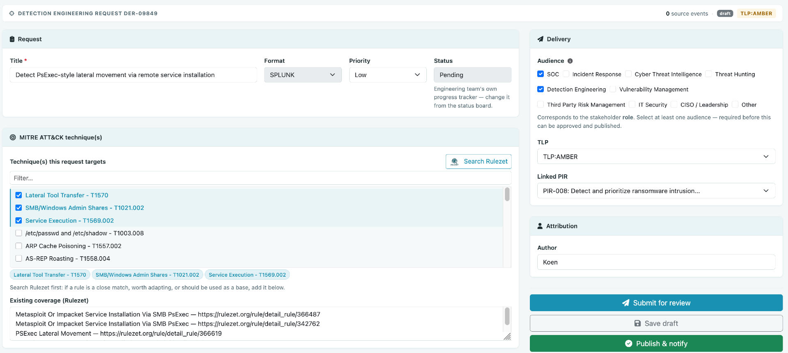
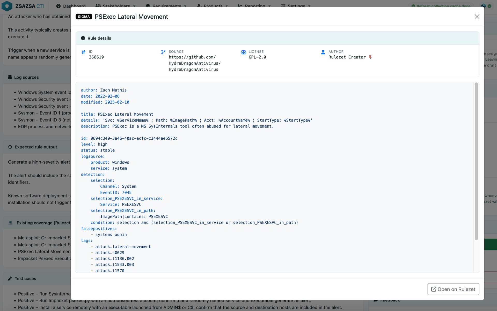
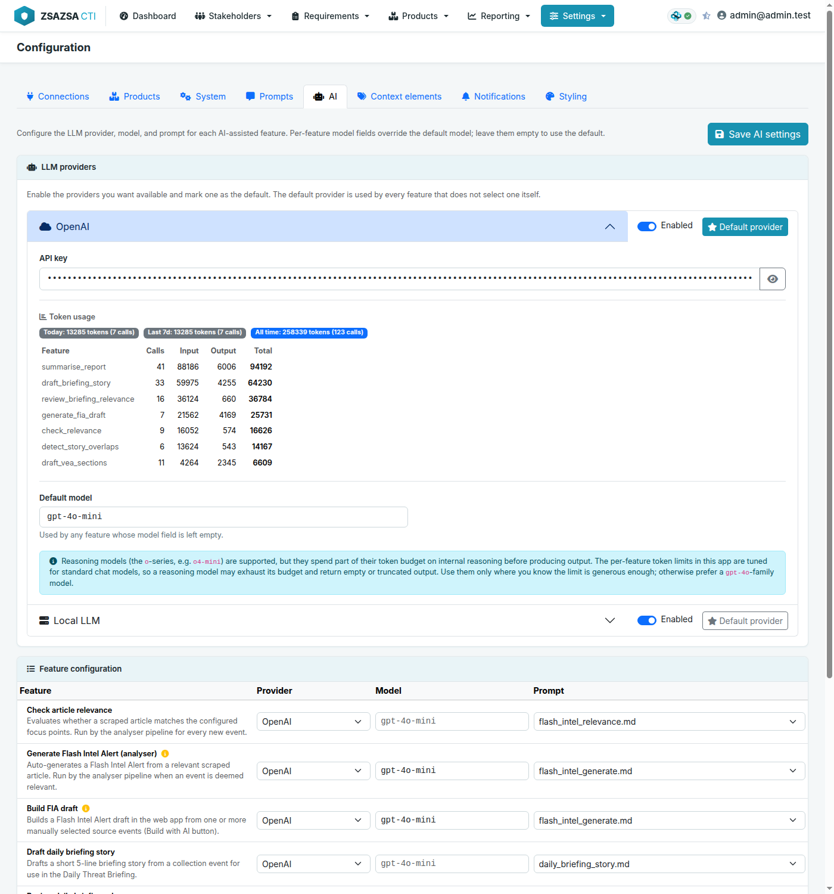

# zsazsa CTI

<p align="center">
  <a href="https://zsazsa-project.org/documentation.html"></a>
  <a href="INSTALL.md"></a>
  <a href="docker/README.md"></a>
  <a href="#configuration"></a>
  <a href="CHANGELOG.md"></a>
  <a href="https://zsazsa-project.org"></a>
</p>

zsazsa is a **CTI program** management and production platform built around [MISP](https://www.misp-project.org/). It links collection, triage, analyst workflows, requirement management, publishing and stakeholder delivery in one place.

It is designed for teams that want to run threat intelligence as an operational capability, not as loose documents and disconnected scripts. In one workflow, analysts can move from source events to intelligence products, align output to PIR and GIR requirements, distribute the products to stakeholders, and collect feedback.

To set zsazsa up, follow the [quickstart](https://zsazsa-project.org/documentation.html): install it with Docker or next to MISP, configure it with the setup wizard, and publish a first briefing. [INSTALL.md](INSTALL.md) has the installation in full, and [Configuration](#configuration) below describes every setting. If you are upgrading, read [CHANGELOG.md](CHANGELOG.md) first: a release can come with a migration you need to run.

This README walks through what zsazsa does, then how it works: the distribution of products, the analyser, newsletters, the configuration and the way records are kept in MISP.

Note that zsazsa is developed with the support of AI.

## Overview


## Intelligence flow

zsazsa follows the daily CTI workflow, from collection through triage and analysis to publishing and feedback. The main areas are:

- **Dashboard** gives a live snapshot of the program: active PIRs and GIRs, stakeholder counts, analyser status, and scraper events still waiting for triage.
- **Stakeholders** record who receives your output, with role, organisation, TLP clearance, product subscriptions and notification channels, plus a power and interest matrix to plan engagement.
- **Requirements (PIR and GIR)** hold the intelligence questions that drive collection, with their scope, ownership and distribution.
- **RFIs** handle one-off requests from intake to closure, with an SLA, an owner, a linked PIR or GIR, response confidence, attachments, notes and feedback.
- **Data collection** is the cached view of the scraper MISP, other MISP servers, and manual or newsletter sources. You browse and triage events, enrich them with scope items from the MISP galaxies, generate an AI summary, and start a product straight from a source event.
- **Products** are a repository of what you publish, with preview and feedback. zsazsa produces Flash Intel Alerts, Vulnerability advisories, Daily threat briefings, Threat landscape reports, Indicator feeds, Threat actor profiles and Detection engineering requests. Publishing a product also publishes its MISP event, without MISP's alert e-mail; indicator feeds are delivered and not published.
- **Statistics** cover pipeline and program metrics, RFI and feedback data, and a scope coverage showing where collection and analysis are concentrated. A CTI-CMM maturity panel maps against levels CTI0 to CTI3.
- **Background jobs** show the analyser runs, AI summaries, deliveries and the scheduled collection runs while they run.


The rest of this section walks through each area with screenshots.

### Records in MISP

zsazsa keeps its data in MISP, using events, object templates, attributes and event reports. This keeps auditability clear and lets teams review the raw records directly in MISP. The MISP **event history** is an audit trail of every change to a product, stakeholder or requirement.


### Dashboard

The dashboard gives a quick **operational overview**, including pipeline state, active requirements, stakeholder info and recent processing results. **Products to review** shows, per product type, how many wait for a review or are drafts.


The built-in CTI reference panel helps teams apply common intelligence concepts, including the Admiralty Scale, TLP and CTI evaluation criteria.


### Stakeholders

Stakeholders are stored in MISP and linked to an organisation. Each record supports internal or external roles, multiple contact fields, TLP clearance, product subscriptions and delivery preferences.


Stakeholders can be **linked to PIRs and GIRs** for ownership and distribution, which makes accountability and delivery easier to track. You are not tied to zsazsa for presenting this information either. The stakeholder list can be exported as Markdown, so it is easy to share or reuse outside the tool.

**Stakeholder matrix**

For each stakeholder you record how much they **influence** the direction of your CTI program (their power) and how much they care about its output (their **interest**). From those two values zsazsa works out the quadrant the stakeholder falls into and places them on a power and interest matrix, so you can see who to engage closely and who to simply keep informed. 


### Requirements

#### PIR

A PIR captures the intelligence question and its context, the intelligence level and its priority, along with the decision it supports and any sub-questions that break it down.

To make collection easier, zsazsa can **highlight events from your data collection sources that match a PIR**. For that to work you add scope elements to the requirement: geographic scope, sector, threat actor, attack technique, vendor and product, or even a specific incident or campaign. Whenever an incoming event matches that scope it is flagged in the data collection view.


**Triage** allows submitted PIRs to be acknowledged, approved, deferred, rejected or merged.


The PIR detail view combines scope, sub-questions, ownership, distribution and collection mapping.


#### GIR

A GIR records intelligence needs over longer cycles, including review cadence, scope and the expected outputs for recurring reporting.


As with a PIR, you can add scope items and threat context to a GIR so that matching events are highlighted automatically in the data collection view.

A PIR can be linked to the GIRs it falls under, on the PIR's form. The GIR page lists the PIRs linked to it.

#### RFI

The RFI workflow covers intake through closure, with priority, SLA, owner assignment, requirement linkage and response tracking.


The RFI detail view lets you add notes and file attachments, and, as with the other requirements, capture feedback from the people who raised the request.


### Data collection

The data collection view provides a cached feed with filters for source, tags and context. It is the **central location for the daily work**, where you navigate between everything from the sources you have set up: the MISP scraper, MISP instances you are connected to, and the manual and newsletter sources you add manually. The scraper is optional: leave its connection empty and collection runs on the other sources alone.


**CTI evaluation** can be applied during collection triage to score relevance and confidence before product drafting.


Events an analyst has looked at and does not want to see again can be **set aside**. For events on your own MISP, meaning the scraper and manual entries, this is the existing reject action, `workflow:state="rejected"`. Events pulled from another MISP are dismissed instead with a local tag, `zsazsa:event="dismiss"`. This is configurable under Configuration > Context elements. Dismissed events stay in the cache but are hidden. To bring one back, remove the tag in MISP.

An analyst can **enrich an event** with scope: geographic reach, targeted sector, threat actor and the techniques used, from the [MISP galaxies](https://misp-galaxy.org/).


If nothing relevant came in through the configured sources, an analyst can also add an article by hand. Its AI summary ticks the scope items it names, for the analyst to check,


or parse one straight from a security newsletter, such as the one from CTI Robot of ETDA.


The newsletter import can also read editions that arrive in **a mailbox over IMAP**.


### Intelligence products
From the same view, analysts can **launch intelligence product creation** from selected source events.


#### Daily threat briefing

**Daily threat briefing** drafting is integrated into the collection workflow.


#### Vulnerability advisory

**Vulnerability advisory** creation is similar, with evidence and indicators from source events.


#### Flash intel alert

In the same way, you can raise a **Flash intel alert** from a threat event.


#### Threat actor profile

zsazsa also lets you build a **threat actor profile**. You usually start from what the MISP galaxies already hold about the actor, use that as a first draft, and expand it with your own knowledge and investigation.


When you combine your own findings with the galaxy data, each profile builds a **Diamond Model** view of the actor across adversary, infrastructure, capability and victim.


When tracking an actor you often want to list the infrastructure you have observed. You do that with a separate product, the indicator feed, and a threat actor profile can be linked to one or more of them.


#### Detection engineering request

When collection turns up a threat you have no detection for, a **detection engineering request** asks the detection engineering team to write one. The request sets out the hypothesis, the technique it covers, the log sources it needs, what a hit should look like and how to test it. Detections you already have, found through Rulezet, go in as existing coverage.

On the status board, **Approve first** opens the request in the table below. Users with MISP publish rights can review it and select **Approve & publish** without leaving the list. Approval publishes the request, starts stakeholder notifications and reloads the list so the board shows the approved state and allows the card to move.

The flash intel alert, vulnerability advisory and detection request forms save drafts or submit them for review rather than publishing while editing. Threat actor profiles save drafts. On the briefing, flash intel alert, vulnerability advisory and threat actor profile lists, **Preview and approve** opens a draft inline. **Approve & publish** is beside **Recipients** at the top of the preview and requires MISP publish rights. Published products keep the normal Preview action. Detection requests use **Approve first** before approval and show Preview only once approved.

Flash intel and advisory previews also offer **QA check against source** and **Reject**, with an optional rejection reason. Rejection returns to the list. **Delete all rejected products** in each list's overview permanently deletes every rejected product of that type, regardless of the current filters, after confirmation. Drafts, products awaiting review and published products are kept.

Daily briefings can also be rejected from their preview or detail page, with an optional reason shown in Metadata. Rejected briefings have their own review-state filter and chart segment. **Delete all rejected products** in the briefing overview removes rejected briefings only, after confirmation, regardless of the current filters. Published briefings cannot be rejected.

The QA check runs as a page request, not a background job. Keep the page open to read its result. Leaving the page loses the result even if the server finishes the check; the audit log records the verdict, not the full findings.



A request is reviewed and approved like any other product. After that it moves along an engineering board (similar to intelligence
requirements): Pending, In Dev, In Test, Active, Retired. It cannot leave Pending before it has been approved, and it never goes back there. Marking a request **Active** needs a draft rule that passes Rulezet's validator, so nothing is announced as live until the rule has been checked. 



### Indicator feed

The indicator feed is another product. You build a detailed query against MISP and get back the matching list of indicators.

Like the other products, it opens on a list of the feeds you have. Each row describes the feed (id, name, TLP, audience), whether it is cached and when it refreshes next, and the actions you need on it: preview the indicators, download them in any of the four formats, notify the stakeholders, edit, delete. **New feed** opens the query builder; saving a query there turns it into a product.

A feed's page contains everything about it in one place. The fields at the top are the product itself, name, TLP, audience, author, linked PIR, feedback date and the caching schedule. Beside them are the product details, the threat actor profiles that embed this feed (each one a link to that product), and the PyMISP query, which updates as you change the filters. The query is one line you can read at a glance, with the full builder folded behind it, and the indicators are underneath with the `+` and `-` buttons that add an event or an organisation to the query. **Run search** replaces only the list of indicators, so the page does not reload and you keep the query in front of you. Nothing is saved until you press **Save changes**.


A useful detail is that the feed is kept as a PyMISP query. zsazsa shows you that query and lets you copy it, so you can reuse it elsewhere.


More often you will not need to copy anything, because zsazsa gives **each feed its own unique URL**. Point a tool at that URL and it pulls the indicators directly, without a login. Only a user with MISP publish rights can switch that URL on or off, on the feed's page. A feed they create starts with it on; one created by anyone else starts with it off. While it is off, the link answers as if it did not exist. When a link has reached someone it should not have, **New token** gives the feed a new URL. The token is stored on the feed in MISP for your organisation only, it does not sync to connected instances. A feed never returns zsazsa's own records, such as other feeds, stakeholders or requirements, even when its query searches zsazsa's own MISP.


A typical use case: your SOC needs a set of indicators to investigate. Instead of copying them by hand or asking the SOC to get the data out of MISP, you build an indicator feed, perhaps tied to a threat actor profile, send it as a product through the notification channels, and the recipients receive it as a plain value list (deduplicated, one unique value per line) or as CSV (one row per matching attribute, with full event/server context, so a value seen on multiple events or servers appears multiple times).

The limit you set on the query sizes the result table and the downloads. Add `truncate=off` when you want the whole set instead:

```
https://zsazsa.example.org/products/indicator-feed/public/<token>?truncate=off
https://zsazsa.example.org/products/indicator-feed/public/<token>?format=csv&truncate=off
```

Without it you get the first `limit` indicators, which is what the table shows. With it you get everything that matches, up to 10000, which is the most zsazsa asks MISP for in one query.

A feed comes in four formats, as a download button on the page and as `format=` on the feed URL:

| Shape | What it holds |
|---|---|
| Values | One unique value per line. What the feed URL returns when you do not ask for a format. |
| Type + value | The same list with `type`, a tab, then the value. Tab-separated because values can contain commas. |
| CSV | One line per matching attribute, with the event and server it came from. |
| JSON | The feed itself (id, name, TLP), when the query ran, the count, and every indicator with its event context and tags. |

```
https://zsazsa.example.org/products/indicator-feed/public/<token>?format=json
https://zsazsa.example.org/products/indicator-feed/public/<token>?format=tsv&truncate=off
```

Next to the formats, **PyMISP** downloads the feed's search as a standalone Python script, for a MISP server with no zsazsa in front of it. It runs the same `misp.search()` the feed runs and prints the values, each once, or every matching attribute as CSV with `--csv`. The server and key come from the environment, so the file holds no credential and no feed token:

```
MISP_URL=https://misp.example.org MISP_KEY=... python3 ports-terminals.py --csv
```

Set `MISP_VERIFY_CERT=false` to skip the TLS certificate check. The script asks the one server it is given, where the feed may read several.

By default every request for a feed runs its query against MISP. A feed that is pulled often does not need that, so it can be cached: switch **Caching** on when you save the feed and pick hourly, daily or weekly. The first request after that runs the query once, writes the result in all four formats under `data/feed_cache`, and every request until the interval passes is served from those files. A cached feed refreshes on the clock of the moment you saved it: save it at 14:16 and it refreshes at :16 past every hour, or at 14:16 each day, or on that weekday at 14:16, so feeds do not all come due at once. The feed page and the list say when each one is next due. The analyser run refreshes the feeds that have come due, so a consumer arriving after that reads a file rather than waiting for the query, and the pipeline page counts how many were refreshed. Each refresh is written to the log under `/logs`, and a feed that could not be refreshed keeps serving what it has and says so on its page and in the list, so you can see that what goes out is older than the schedule promises. A feed that goes stale between runs is refreshed by the first request for it, exactly as an uncached feed is. If that request cannot reach MISP either, the feed hands out the copy it already has rather than an empty answer: a tool pulling the URL cannot tell an empty feed from an outage and would drop every indicator it holds. The feed page and the list say that the last refresh failed, so you can see what you are looking at. The feed page shows how old the cache is, the list shows which feeds are cached and how often they refresh, and the results table on a cached feed is marked **live** because it always queries MISP while the downloads and the feed URL serve the cache. Saving a feed drops its cache, so a changed query takes effect at once, and `truncate=off` always runs the query.

### Statistics

The statistics pages combine operational metrics with CTI maturity info.


The scope statistics show how often each scope value is used across PIRs, GIRs, threat actor profiles and daily briefings. Clicking a value opens the entries behind the number, each one linking to its detail page, so you can see straight away which requirements and products claim a given country, sector or technique.

### AI support

AI-assisted features support analyst efficiency in triage, relevance checking and drafting.

zsazsa works with two kinds of LLM provider: **OpenAI**, and a **local LLM** reached over an OpenAI-compatible API such as the one [Ollama](https://ollama.com/) exposes. Both are set up on the AI tab of the configuration page. Each provider can be enabled or disabled on its own, and one of the two is marked as the default provider. Running a local model keeps event content on your own infrastructure, which matters because these features send raw MISP event text to whichever provider is configured.

The OpenAI card holds the API key, the token usage counters and the default model. The local LLM card holds the network location of the server, an API key for servers that ask for one, and its own default model. The network location is the base URL of the endpoint, for example `http://127.0.0.1:11434`, and the `/v1` path is added for you if you leave it off. Token usage is recorded per provider, so local calls are counted separately from OpenAI ones.



Each feature chooses its own **provider, model, temperature and prompt** in the feature table under the provider cards. An empty model field means the feature uses the default model of the provider it points at, and an empty temperature leaves sampling to the model. A provider that is switched off is no longer offered in the table, and it cannot be switched off while features are still pointing at it.

Alongside relevance checking, briefing stories, report summaries and advisory drafts, three options work on the products themselves. A **threat actor profile** can be drafted from the selected actors and the MISP galaxy context. A **threat landscape report** can be drafted from the events in its dataset, or from the queue while it has none. A **flash intel alert or vulnerability advisory** can be audited against its source events before publishing.

Two things to watch with a local model. An empty temperature leaves sampling to the model, which locally can mean a value as high as 1.0; almost every feature parses the answer back into structured data, so a low temperature keeps it stable. And reasoning models spend part of the token budget thinking before they answer, while the per-feature budgets are sized for a straight answer; zsazsa asks the model to skip the thinking step (`reasoning_effort` "none"), which Ollama and OpenAI's reasoning models honour, but a server that ignores the request can spend the whole budget and return nothing.

### Detection rules from Rulezet

[Rulezet](https://rulezet.org) is a community repository of public detection rules, written in Sigma, YARA, Suricata, Elastic and other formats.

Five products can use it: the daily threat briefing, flash intel alert, vulnerability advisory, threat actor profile and detection engineering request. **Search Rulezet** takes the CVE IDs or MITRE ATT&CK techniques on the product and looks for rules that match them. The results come back as a filterable table, and you can read any rule, syntax highlighted, before deciding to use it.

What gets saved is the rule's name and a link to it, not a copy. That keeps the product small and leaves the rule where it is maintained. Each of those links has a view button beside it that fetches the rule and opens it in the same viewer, so you can check what a detection does without leaving zsazsa.

Rulezet is *optional*. Leave `RULEZET_URL` empty and the search buttons are disabled.

### Background jobs

The work that takes longer runs in the background: an analyser action started from the dashboard, a batch of AI summaries from data collection, a single summary on one event, and the scheduled analyser and mailbox runs. 

A **badge in the top bar** displays the running jobs. A job that stops reporting for half an hour is shown as stalled rather than spinning forever. Scheduled runs are also in the job list. So a cron analyser run is visible while it is running and not only once it appears in the history. The job state is kept in **Redis**.  The **Pipeline page** holds the history logs of the jobs. Entries whose source event has since been rotated out of the scraper MISP are hidden until you switch on *Include orphaned*, and *Purge orphaned* drops those rows for good.

### Collection source management

Source management lets you manage **data collection sources** centrally, including manual sources and additional MISP instances.


## Notification and distribution flow

The product distribution is built around stakeholders, roles, product subscriptions, audiences and notification channels. The intended flow is as follows.

**Stakeholders**

- A stakeholder is created and takes on exactly one role (SOC, Incident Response, Cyber Threat Intelligence, and so on). 
- Each stakeholder indicates which notification channels they want to receive products on. 
- A stakeholder also subscribes to one or more product types.

**Products**

- A product is created with one or more audiences. An audience is a stakeholder role, so selecting an audience selects the set of stakeholders holding that role. 
- When a product is published, every selected audience is resolved to its matching stakeholders, and a stakeholder receives the product only if all of the following are true
    - the stakeholder's role is in the product's audience
    - the stakeholder is subscribed to that product type, 
    - and the stakeholder's TLP clearance is high enough for the product's TLP. 
- Eligible stakeholders then receive the product over the notification channels they configured. 

**Channels**
A channel can accept every product, or it can be restricted to specific product types. [Flowintel](https://flowintel.org/) is an example of a restricted channel: a case is created only on the Flowintel instances those recipients subscribed to, and only for products that are enabled for that instance in its `case_templates` configuration.

## What the analyser does

The dashboard has a **Start analyser** button with three options: **Daily threat briefing**, **Flash intel alert** and **Vulnerability advisory**. All three start from the same events, but each one decides differently what to do with them. None of them publish anything or notify stakeholders. They only create **drafts** that you then review, edit and publish yourself.

### Executed for all three options

1. Refreshes the data collection cache.
2. Asks the scraper MISP for events dated **today** (UTC) that have the scraper tag (`SCRAPER_MARKER_TAG`), up to `MISP_SCRAPER_LIMIT` events, and the webapp MISP for the manual entries of today that have a report. A manual entry without one is left for you, as there is nothing for the AI to read.
3. Keeps only events that still need work, with workflow state `incomplete` or `ongoing`. Events marked `complete` or `rejected` are left alone.
4. Drops events it cannot use: the article could not be fetched (HTTP error) or the report is empty. These are `rejected`.
5. For each remaining event it makes sure there is an AI summary report, and creates one if it is missing, on the MISP the event is on. When the model or MISP fails on one event, that event goes on without a summary and the run continues with the others. The next scheduled run reads it again for its summary.

### Daily threat briefing

This option is about **situational awareness**, though what your requirements track is always in it.

1. It applies the title exclusion list (`DAILY_BRIEFING_TITLE_EXCLUSIONS`) and skips events already used in an earlier briefing.
2. For each event it asks the AI whether the story is useful to defenders: concrete threat information such as an incident, a campaign, an exploited CVE or attacker techniques, rather than marketing, company news or general trends. The AI is not given your focus points or requirements for this. Events that are not useful are rejected, with the reason written back onto the event. An event that matches an active PIR or GIR, which zsazsa decides from its tags and galaxies, is not asked about: it is always in the briefing, also when it got a flash intel alert.
3. For the events it keeps, it drafts a short write-up with your focus points in mind, extracts sectors, geographies, techniques, threat actors and vendors, and removes near-duplicate stories.
4. From the stories that survive, it writes the **briefing summary**: a few sentences covering the day as a whole, grouping the stories that share a sector, geography, actor or technique.
5. The result is one **daily briefing draft** holding the day's stories, ready to review and publish.

### Flash intel alert

This option is **requirement-driven**. It only acts on events that match something you are actively tracking.

1. For each event it compares the event's tags and galaxy clusters against the scope of your **active PIRs and GIRs**.
2. An event that matches at least one PIR or GIR gets a **flash intel draft**, pre-filled with the summary and linked to the best-matching PIR.
3. An event that matches nothing is skipped and logged as **"no PIR/GIR match"**. It is not an error. It means the event was not relevant to any current requirement.
4. If you have no active PIRs or GIRs, or none whose scope fits today's events, this option creates nothing. 

### Vulnerability advisory

This option is **CVE-driven**.

1. For each event it looks for a CVE in its vulnerability attributes, and otherwise in its title.
2. An event with at least one CVE gets a **vulnerability advisory draft**. The CVE is enriched from a vulnerability database (CVSS score, affected products and versions, description) and the advisory sections are drafted by the AI.
3. An event with no CVE is skipped and logged as **"no CVE found"**. So is one whose CVEs are already in a draft or an advisory in review.
4. With the **asset database** on (Settings > Products), only a CVE in a product of your inventory makes a draft. See [Products](#products).

### The three options side by side

| Option | What it acts on | What it skips, and why | Output |
|---|---|---|---|
| Daily threat briefing | Today's scraped events and manual entries the AI judges useful to defenders, and those that match an active PIR or GIR | Off-topic stories, excluded titles, events already briefed | One daily briefing draft with the day's stories |
| Flash intel alert | Today's scraped events and manual entries that match an active PIR or GIR | Events logged as "no PIR/GIR match" | One flash intel draft per matched event |
| Vulnerability advisory | Today's scraped events and manual entries that mention a CVE | Events logged as "no CVE found" | One vulnerability advisory draft per CVE event |

In every case the analyser stops at drafts. Publishing and sending to stakeholders is always a separate step you take by hand. The drafts come with an audience, which an alert or advisory needs before it can be published: a flash intel alert from a PIR or GIR is for the roles of the requirement's owner and of the stakeholders it is distributed to, and any other alert or advisory for the roles of everyone who can receive it, its subscribers cleared for its TLP. Narrow it down before publishing where that is too wide. The alert and advisory lists show under each title why the analyser made the draft.

### The scheduled analyser

`run_analyser.py` runs from cron or in the analyser container. By default it only makes flash intel alerts from focus points. Under Settings > System > Analyser you can also switch on the three options of **Start analyser**.

**Alerts from focus points.** Each run reads the `incomplete` scraper events, and the manual entries with a report, since the previous run, at most `POLL_WINDOW_HOURS` back. The AI checks each article against the focus points. A match becomes a draft flash intel alert at TLP amber, and the source event moves to `ongoing`. What happens to an event that matches no focus point depends on the daily briefing. With the scheduled briefing on, the event stays `incomplete`, and the briefing judges it in the evening with its own question: is it useful to defenders? So the briefing covers the whole day, while the alerts stay strict. With the briefing off, the event is rejected, unless it matches an active PIR or GIR, so a briefing started from the dashboard still has it. That match is read from the event's tags and galaxies, which the AI summary adds: switch on the alerts from PIRs and GIRs or the advisories as well, and the summaries are written before this check. With the scheduled briefing on, the data collection queue and the dashboard's pending count therefore hold more open events during the day, until the briefing has run. For a stakeholder subscribed in **automated** mode, the alert is published and sent without review.

**The Start analyser options** work as described above, but also read yesterday's events, so late events are not missed. The alerts from PIRs and GIRs and the advisories, which run every hour, only read the events that came in or changed since their previous scheduled run, so an event is not checked and logged again every hour. The daily briefing is made once a day, from `ANALYSER_DAILY_BRIEFING_HOUR` (UTC). In a run, the alerts from PIRs and GIRs and the advisories go first, then the alerts from focus points, and the briefing last: the check against the focus points can reject an event that matches no focus point, and the briefing rejects the events it finds not useful, which would take them out of the others. An event that got an alert from a PIR or GIR earlier in the run is not checked against the focus points, since it has its alert. One that got an advisory is, so a CVE in a product you run can also get an alert. Each option first writes the missing AI summaries, which adds a model call per new event.

An event never gets more than one flash intel alert.

## Importing newsletters

Many teams receive curated security newsletters by e-mail, where one edition can list dozens of articles. Rather than copy them in one by one, the newsletter importer turns a pasted e-mail into a reviewable list. Open it from the Data collection page with "Import from newsletter", choose the format, paste the e-mail and select "Parse and review". The importer extracts each article, its links and whatever grading the newsletter gives them.

Two formats are supported: the **ETDA Cyber Threat Intelligence (CTI Robot)** digest and **IT-ISAC Open Source News**. ETDA grades every item, so its **critical** and **urgent** articles are pre-selected and you only confirm what is worth collecting. IT-ISAC does not grade its items, so nothing is pre-selected there and you pick the articles yourself.

Sending does two things. Each selected link is sent to misp-scraper, which fetches the article and creates a MISP event. The newsletter itself is archived as its own MISP event, with the raw e-mail kept as a report and the links attached.

### Technical notes

Each newsletter format has its own parser in `webapp/newsletter_parsers.py` (the `PARSERS` map), so supporting a new format means writing one parser and registering it. Parsing is pure text processing and never touches MISP.

The hand-off to the scraper uses Redis publish/subscribe: zsazsa publishes one JSON message per selected article on the configured channel, and the scraper's `subscribe` service consumes it. The connection (`SCRAPER_REDIS_HOST`, `SCRAPER_REDIS_PORT`, `SCRAPER_REDIS_PASSWORD`, `SCRAPER_REDIS_CHANNEL`) is set on the "Manual sources pushing to scraper" card, and is separate from the Redis that zsazsa reads MISP login sessions from and from the one that holds background job state.

Each message holds the article link, the title, the newsletter name as the feed title, and `feed_tags` that the scraper applies as local tags on the created event.

### Collecting newsletters from a mailbox (IMAP)

Instead of pasting each edition by hand, zsazsa can read newsletters straight from a mailbox. Forward the newsletter (for example the ETDA digest) to a mailbox, and zsazsa polls that mailbox, processes new editions the same way the manual importer does, and marks the e-mail as handled so it is never processed twice.

Mailboxes are configured on the Collection sources page (`/config/sources/`) under "IMAP mailboxes". A mailbox holds the connection (host, port, SSL, credentials and the folder to read). Under it you add one or more **data collection sources**, one per newsletter, each with a name, the parser to apply, match criteria (subjects and senders, one per line), an Admiralty reliability rating and a mode. A message goes to the first source whose subject or sender matches. The sender match also reads the original `From:` line inside a forwarded message, so forwarding does not hide the real sender. Passwords are stored in `config/__init__.py` under `IMAP_SOURCES`, never in a MISP event.

The source name is what events are attributed to: `scraper:data-collection-source:<name>`.

Each source runs in one of two modes. In **automatic** mode a matched newsletter is archived and its links are pushed to the scraper straight away. In **manual review** mode it is archived and put in a pending queue, so a human picks the articles first, from the Data collection page under "Email sources". If an automatic push finds no scraper listening, the edition moves to the pending queue rather than being lost, so you can retry it.

#### Example: adding IT-ISAC Open Source News to an existing mailbox

A mailbox can hold several newsletters, so a second one is added as another collection source rather than as another mailbox. On the Collection sources page (`/config/sources/`), under **IMAP mailboxes**, click the header of the mailbox that receives the newsletter to open it. Inside, the **Data collection sources** panel lists the sources already configured for that mailbox, with an **Add source** button. Add one and fill it in:

| Field | Value |
|---|---|
| Name | `IT-ISAC` |
| Parser | `IT-ISAC Open Source News` |
| Mode | `Automatic`, or `Manual review` to pick the articles yourself |
| Match subjects | `[IT-ISAC]` |
| Match senders | leave empty |
| Reliability | your own assessment of the source, for example `B` |

Leave **Enabled** on and press **Save** on the source itself, not only on the mailbox. The next poll then picks up the edition, archives it and handles its articles according to the mode.

Match on the subject rather than the sender for this one. IT-ISAC distributes through the FIRST `first-news` mailing list, so the message arrives with `first-news@lists.first.org` in its `From` header and the `it-isac.org` address only in `Reply-To`, which the sender match does not read. A sender term of `it-isac.org` therefore matches nothing. `lists.first.org` would match, but it also catches every other message from that list and hands it to a parser that will find no articles in it. `[IT-ISAC]` appears in the subject of every edition and nowhere else.

Unlike the ETDA digest, IT-ISAC does not grade its articles, so none are pre-selected in manual review and you tick the ones worth collecting.

Polling is done by `run_imap_collector.py`. In Docker the `imap-collector` container runs it every 15 minutes; a standard installation runs it from cron:

```
*/15 * * * * cd /var/www/MISP/misp-custom/zsazsa && venv/bin/python run_imap_collector.py
```

The Pipeline page (`/pipeline`) shows each mailbox with its last poll and result, and every poll also appears in the run history. Processed messages are flagged with a dedicated IMAP keyword (`zsazsaProcessed`) and marked Seen and Flagged; the keyword, not the read state, is what prevents reprocessing, and nothing is ever deleted from the mailbox.

## Configuration

Almost all runtime settings are in `config/__init__.py`, which is `docker/volumes/config/__init__.py` in Docker. Most of them can be changed from the web interface, under Settings: the Configuration page has the tabs described below, Collection sources has the [data collection sources](#data-collection-sources), and the setup wizard walks through what a new install needs. Saving regenerates the whole file from a fixed template rather than editing lines in place. Anything you added by hand that the template does not know about is dropped, and the file is backed up to `config/__init__.py.backup` before each save. After editing the file by hand, restart zsazsa.

The Configuration and Collection sources pages and the setup wizard are for MISP site admins only (`perm_site_admin` on the user's role), and the Settings menu is hidden from everyone else. Without single sign-on everyone works as the same identity and the pages stay open to all. See the single sign-on section under System for when zsazsa treats single sign-on as in use.

Keys and passwords are never shown again once saved. A field holding one reads "Configured, leave blank to keep": type a new value to replace it, or leave it empty to keep it. Where a secret can be left unset, such as the SMTP password or an LLM key, a "Remove" box under the field clears it. A stored secret stays with the address it was entered for: changing a URL or host means entering its key or password again, and the connection tests only use a stored secret against its own address.

### Connections

This tab covers the MISP server zsazsa uses as its own **data store**, configured through `MISP_WEBAPP_URL`, `MISP_WEBAPP_KEY` and `MISP_WEBAPP_VERIFYCERT`.

| Setting | Description |
|---|---|
| `MISP_WEBAPP_URL` | URL of the MISP server zsazsa uses to store its own program data |
| `MISP_WEBAPP_KEY` | API key for the webapp MISP server. It needs no site admin, but the Configuration page warns when its role lacks a permission zsazsa uses, such as publishing or tagging, or when the key is read-only |
| `MISP_WEBAPP_VERIFYCERT` | Whether to verify the webapp MISP server's TLS certificate. On by default; see below for a MISP whose certificate comes from your own CA |
| `RULEZET_URL` | Base URL of a [Rulezet](https://rulezet.org) instance. Product forms search it for public detection rules by CVE ID or MITRE ATT&CK technique, and a product page reads a saved rule back from it. A detection engineering request also validates its draft rule against it. Leave empty to disable the lookup |

zsazsa checks a MISP server's certificate against the CA list that ships with Python's requests package, not the host's. For a MISP whose certificate comes from your own CA, leave verification on: add the CA to the host (on Debian or Ubuntu, copy it to `/usr/local/share/ca-certificates/` and run `sudo update-ca-certificates`), then set `REQUESTS_CA_BUNDLE=/etc/ssl/certs/ca-certificates.crt` for the web app (an `Environment=` line in the systemd unit) and in front of the analyser and IMAP collector cron entries. Point it at the host's whole bundle rather than at your CA alone, or the public services zsazsa calls stop verifying. Turning verification off instead sends the API key to whatever answers at that address.

### Products

The Products tab covers how products and requirements are categorised and summarised. `PRODUCT_TYPES` defines the catalogue of CTI product types offered when creating a product. `DAILY_BRIEFING_TITLE_EXCLUSIONS` lists story titles or phrases that the daily briefing analyser should ignore when proposing stories. The five `FOCUS_POINTS_*` lists (geographies, sectors, technologies, threat types and threat actors) define the organisation-wide focus points used when previewing relevance against scraper events and when generating AI summaries. `THREAT_ACTOR_TYPES` is a small table of threat actor type names and descriptions, based on the ENISA taxonomy, used when classifying threat actors in products and requirements.

The **Vulnerability advisory** card holds the **asset database**. With it on, the analyser only makes a vulnerability advisory for a CVE in a product you run: it looks for the CVE's supplier and product, as the vulnerability database lists them, in your inventory. An event without a match is logged as "not in the asset inventory", and a matched advisory names the asset under "Our exposure". A CVE whose record names no product, because it is still reserved or its lookup failed, cannot be checked: it makes a draft whose "Our exposure" says so, for the analyst to decide, unless another CVE of the event is in the inventory. Names are compared loosely: case, punctuation and company forms such as "Inc." do not count, "PAN-OS" is "PANOS", and a supplier matches its initials, so "HPE" is Hewlett Packard Enterprise. The version is shown but not compared. An advisory made by hand is not checked. The inventory is a CSV file for now, one asset per line as `"Supplier","Product","Version"`, read again every `ASSET_INVENTORY_REFRESH_MINUTES`; with Docker, put it under `volumes/data`. The card says how many assets the file holds, or why it cannot be read, and a file that cannot be read fails the advisory run.

| Setting | Description |
|---|---|
| `PRODUCT_TYPES` | Catalogue of CTI product types offered when creating a product |
| `DAILY_BRIEFING_TITLE_EXCLUSIONS` | Story titles or phrases the daily briefing analyser should ignore |
| `FOCUS_POINTS_GEOGRAPHIES` | Organisation-wide geography focus points |
| `FOCUS_POINTS_SECTORS` | Organisation-wide sector focus points |
| `FOCUS_POINTS_TECHNOLOGIES` | Organisation-wide technology focus points |
| `FOCUS_POINTS_THREAT_TYPES` | Organisation-wide threat type focus points |
| `FOCUS_POINTS_THREAT_ACTORS` | Organisation-wide threat actor focus points |
| `THREAT_ACTOR_TYPES` | Threat actor type names and descriptions (ENISA taxonomy) |
| `ASSET_INVENTORY_ENABLED` | Only make a vulnerability advisory for a CVE in a product of the asset inventory |
| `ASSET_INVENTORY_FILE` | The asset inventory, a CSV file of `"Supplier","Product","Version"` rows |
| `ASSET_INVENTORY_REFRESH_MINUTES` | How often the asset inventory is read again |

Renaming a product type does not rename it in the stakeholder subscriptions already stored in MISP. The System tab has a migration for the one rename that shipped with zsazsa ("Vulnerability exploitation advisory" to "Vulnerability advisory").

### System

The System tab holds six cards.

**MISP event distribution** sets `MISP_EVENT_DISTRIBUTION`, the distribution level given to every event zsazsa creates in MISP.

**Analyser** contains `POLL_WINDOW_HOURS` (how far back the analyser looks for new events on each run), what the scheduled analyser makes (see [The scheduled analyser](#the-scheduled-analyser)), `EVENT_LOG_RETENTION_DAYS` (how long rows in the `event_log` table are kept), `PIPELINE_RUN_LOG_RETENTION_DAYS` (how long pipeline run history is kept) and `AUDIT_LOG_RETENTION_DAYS` (how long the audit log under Reporting > Logs is kept, 0 for good). A product's delivery badge comes from the audit log, so it goes when the entry does. **Logging** sets `LOG_LEVEL`. **Web server** covers `HOSTNAME` and `PORT`, plus `SSL_ENABLED`, `SSL_CERT` and `SSL_KEY` for running the built-in server with TLS. After changing the port or SSL settings, restart the application for the change to take effect. zsazsa listens on `0.0.0.0` unless `ZSAZSA_BIND` in its environment names another address, and `ZSAZSA_PORT` there takes the place of `PORT`; the Docker setup sets both. `HOSTNAME` does not change the listener: it is kept for reference and for building links.

**Single sign-on** is described in its own section below.

**Migration** lists the one-off maintenance scripts that rewrite existing data in MISP. Each one runs as a dry-run first and reports what it would change, then applies the change when you run it for real. The scripts are `scripts/make_zsazsa_tags_local.py` (re-attach `zsazsa:` namespace tags as local tags so they never sync to connected instances), `scripts/rename_vea_subscription_product.py` (rewrite the old VEA product name in stakeholder subscriptions), `scripts/backfill_product_source_log.py` (record the source events of products created before source logging existed), `scripts/convert_url_attributes_to_link.py` (retype the external references on manual collection entries) `scripts/align_requirement_scope_focus_points.py` (give a PIR or GIR the scope items its scope lists imply, and the other way round) and `scripts/restore_rfi_ids.py` (put back the id of an RFI that lost it when its feedback was saved before 1.0.0). Only these can be launched from the page, and the browser only ever sends a migration id, never a path.

| Setting | Description |
|---|---|
| `MISP_EVENT_DISTRIBUTION` | Distribution level for events zsazsa creates: 0 your organisation, 1 this community, 2 connected communities, 3 all communities |
| `POLL_WINDOW_HOURS` | How far back the analyser looks for new events on each run |
| `ANALYSER_FLASH_INTEL` | Make flash intel alerts from focus points (on by default) |
| `ANALYSER_FLASH_INTEL_REQUIREMENTS` | Make flash intel alerts from PIRs and GIRs |
| `ANALYSER_VULNERABILITY_ADVISORIES` | Make vulnerability advisories |
| `ANALYSER_DAILY_BRIEFING` | Make the daily briefing |
| `ANALYSER_DAILY_BRIEFING_HOUR` | Hour (UTC) from which the daily briefing is made |
| `EVENT_LOG_RETENTION_DAYS` | How long rows in the `event_log` table are kept |
| `PIPELINE_RUN_LOG_RETENTION_DAYS` | How long pipeline run history is kept |
| `AUDIT_LOG_RETENTION_DAYS` | How long the audit log is kept (365 days by default, 0 keeps it for good) |
| `LOG_LEVEL` | Logging verbosity |
| `HOSTNAME` | Hostname or IP shown for reference and used to build links |
| `PORT` | Port the application listens on |
| `SSL_ENABLED` | Whether the built-in server uses TLS |
| `SSL_CERT` | Path to the TLS certificate file |
| `SSL_KEY` | Path to the TLS private key file |

#### Single sign-on against MISP

zsazsa has no user accounts of its own. It identifies the analyst from MISP's own session. This only works when zsazsa is served under the same host as MISP. The cookie is named `MISP-<instance uuid>` and is therefore unique per install. You do not need to look it up: enable single sign-on and save, and zsazsa queries the MISP server for its instance UUID and stores the resulting name in `MISP_SESSION_COOKIE_NAME`. The name is derived from, and the login redirect points at, the MISP server configured as `MISP_WEBAPP_URL`, which is the instance zsazsa is served behind and whose session cookie the browser sends. The misp-scraper instance in `MISP_URL` is not involved.

SSO against MISP requires three things:

- **PHP must keep MISP's sessions in Redis**, since that is where zsazsa reads them. Set `session.save_handler = redis` and `session.save_path = "tcp://localhost:6379"` in your PHP configuration, and point `MISP_SESSION_REDIS_*` in `config/__init__.py` at the same instance. With sessions in files instead, zsazsa finds nothing and treats every visitor as unauthenticated.
- **The database has to match.** PHP writes its sessions to the database named in `session.save_path`, which is `0` when it names none. That is not the `redis_database` in MISP's settings, which is `13` by default and is for MISP's own caching. Setting `MISP_SESSION_REDIS_DB` to `13` points zsazsa at a database with no sessions in it.
- **The cookie name has to match.** `MISP-<instance uuid>` is what current MISP uses, but the name comes from MISP's own configuration, and installs that leave it at the CakePHP default send `CAKEPHP`. Set `MISP_SESSION_COOKIE_NAME` by hand when it differs.

All three failures look the same from the outside: nobody is ever identified, and with the redirect on it resembles a login loop. The **Test single sign-on** button in the Single sign-on section tells them apart. It reports which cookie name zsazsa expects, which cookies your browser actually sent, whether Redis is reachable and on which database, and whether a session was found. When the sessions turn out to be in another database of the same Redis, it names that database and the setting to change.

A session lasts as long as MISP lets it. MISP ends a session when `Session.timeout` passes, and zsazsa treats it as ended at the same moment, even when its Redis key lives on for `Session.cookieTimeout`. Using zsazsa counts as activity: while you work in it, opening pages and taking actions, zsazsa asks MISP for your own user record with your session cookie every five minutes (`/users/view/me.json`), or sooner when less than five minutes are left, and MISP changes the session's expiry. With `Session.autoRegenerate` on, zsazsa skips the request that would give the session a new ID, and leaves that to MISP's own pages. What a page fetches in the background, such as the job list in the top bar, does not count, so a zsazsa tab left open does not keep the session alive. zsazsa never writes the session itself. 

With `MISP_SESSION_REDIRECT_TO_LOGIN` on, a visitor without a valid MISP session is redirected to MISP's login page. With it off, such requests fall back to the `admin@admin.test`. Users seen through a session are recorded and listed on the community page. Two URLs stay reachable without a session because they are meant to be handed out. The public indicator feed URL has a random token per feed. The URL of the Diamond Model image that a Mattermost or Teams notification shows is signed with `SECRET_KEY`, works only for a published profile, and stops working when `SECRET_KEY` changes.

Approving, publishing and (re)sending a product, delivering an indicator feed or switching its public URL on or off, and setting a stakeholder's product to automated delivery, take MISP's own **publish** permission (`perm_publish` on the user's role). The Configuration and Collection sources pages take **site admin** (`perm_site_admin`).

MISP keeps the role a user had when they logged in, so the publish check and the Settings menu only follow a role change after the user logs in to MISP again. The settings pages themselves ask MISP for the current role on every visit, so making someone site admin, or taking it away, counts straight away. zsazsa asks with the user's own session. When MISP cannot be asked, the settings stay closed and the zsazsa log says why.

Both checks need to know who you are. zsazsa treats single sign-on as in use when `MISP_SESSION_REDIRECT_TO_LOGIN` is on, when `MISP_SESSION_COOKIE_NAME` is set, or once it has recognised anyone through a MISP session (they are listed on the community page). From then on, a request without a user may not publish or open the settings. That covers the `admin@admin.test` fallback and a session Redis that is down, so leaving the cookie out never gets anyone past the checks.

Without single sign-on, everyone works as the same trusted identity and can do everything. To go back to that mode after using it, clear `MISP_SESSION_COOKIE_NAME`, turn the redirect off, empty the list of recognised users with `sqlite3 data/analyser.db 'DELETE FROM sso_users'` (or the `DB_FILE` you set), and restart zsazsa.

| Setting | Description |
|---|---|
| `MISP_SESSION_REDIRECT_TO_LOGIN` | Redirect visitors without a MISP session to MISP's login page |
| `MISP_SESSION_COOKIE_NAME` | MISP's session cookie name, detected automatically when left empty |
| `MISP_SESSION_REDIS_HOST` | Host of the Redis instance MISP stores its sessions in |
| `MISP_SESSION_REDIS_PORT` | Port of that Redis instance |
| `MISP_SESSION_REDIS_DB` | Database PHP writes the sessions to, from `session.save_path` and `0` when it names none. Not MISP's own `redis_database`. |
| `MISP_SESSION_REDIS_USERNAME` | Username, when the instance uses ACLs |
| `MISP_SESSION_REDIS_PASSWORD` | Password, if the instance requires one |

The `MISP_SESSION_REDIS_*` settings decide who every visitor is, so they are set in `config/__init__.py` only. The System tab shows them read-only, a save from the interface keeps them as they are, and zsazsa needs a restart to pick up a change.

### Prompts

This tab lists every prompt template file found in `zsazsaprompts/`. 

| Prompt file | Constraint |
|---|---|
| `summarise_misp_report` | Must keep its `**Targeted sector:**`, `**Geographic scope:**`, `**MITRE ATT&CK techniques:**`, `**Threat actor:**` and `**Vendor/Technology:**` headings |
| `flash_intel_generate` | Must keep its overall section and field structure, since the "Generate AI draft" feature reads it line by line |
| `flash_intel_relevance` | Must keep returning the `relevant`, `matched_focus_points`, `source_type`, `confidence` and `reason` JSON keys |
| `daily_briefing_story` | Must keep the five-line structure followed by the `Threat actor type: <type>` line, which is parsed out separately |
| `daily_briefing_relevance` | Must keep returning only the `include` and `reason` JSON keys |
| `daily_briefing_overlap` | Must keep returning the `summary` and `overlaps` JSON structure, with 1-based story indexes |
| `daily_briefing_summary` | Must keep returning one plain paragraph, since it is rendered as-is at the top of the briefing preview, mail and PDF |
| `vea_draft`, `threat_actor_profile_draft`, `threat_landscape_trends`, `product_qa_review` | Must keep returning the JSON keys they list, since each key fills a named form field or panel |

Changing these headings or structure will cause the corresponding feature to fail silently.

Three prompts support the drafting and review buttons on the products themselves. `threat_actor_profile_draft` fills the narrative fields of a threat actor profile from the selected actors, the MISP galaxy context and any notes already on the form, and only ever writes into fields the analyst left empty. `threat_landscape_trends` drafts the threat landscape report from the events in its dataset, or from the queue for a new report, counting the events behind each trend and leaving `[ANALYST]` markers where the organisational judgement belongs. `product_qa_review` backs the "QA check against source" button on flash intel alert and vulnerability advisory drafts: it audits the draft against the report content of its source events and returns a verdict with the claims a reviewer should fix before publishing.

### AI

The AI tab starts with the LLM providers card, one section per provider. **OpenAI** takes an API key and a default model, and shows its token usage. **Local LLM** takes the network location of a server that speaks the OpenAI API, an API key for servers that require one, and its own default model. The network location is the base URL of the endpoint, for example `http://127.0.0.1:11434` for a local [Ollama](https://ollama.com/); the `/v1` path is appended automatically when it is missing. Ollama ignores the API key, so leave it empty unless the server is behind a proxy that checks it.

Each provider has its own enable switch, and one provider is marked as the default with the "Default provider" button. A provider cannot be disabled while features still point at it.

**AI-connector MISP module** is the [ai-connector](https://github.com/cudeso/ai-connector) misp-modules server, with the settings MISP has for it under `Plugin.AI_*`. On misp-docker it is at `http://ai-connector`, port 6667. Give an Ollama model with its tag, for example `llama3.1:latest`. It runs its own prompts, so no feature can choose it; its "Summarise MISP event" is a fixed row in the feature table. "Test connection" checks the module and the model, as MISP's "Test LLM" does. In data collection it summarises events from another MISP server, once "Allow adding reports to events" is on for that server under Collection sources. A new server has it off. The summary is saved as an `[AI-Event-Summary]` report.

Below the providers, a table lists each AI-assisted feature (for example summarising a report or generating a Flash Intel Alert draft) with the provider it uses, an optional per-feature model override, a sampling temperature, and the prompt file it uses. An empty model field means the feature uses the default model of its provider. An empty temperature leaves sampling to the model, which for a locally hosted model can mean a value as high as 1.0; since almost every feature here is parsed back into structured data, a low temperature between 0 and 0.2 keeps that output stable. Not every model takes every setting: an OpenAI reasoning model only accepts its default temperature while it reasons, and older models do not know `reasoning_effort`. A model that refuses one is asked again without it, once, and zsazsa remembers that for the model. This feature-level configuration is stored separately, in `data/ai_features.json`, rather than in `config/__init__.py`, and is therefore untouched by a Settings save and not covered by the config backup.

Token usage is recorded per provider in the `llm_usage` table of the analyser database and shown in each provider's section. Rows written before local LLM support are counted as OpenAI usage.

| Setting | Description |
|---|---|
| `LLM_DEFAULT_PROVIDER` | Provider used by features that do not choose one: `openai` or `local` |
| `OPENAI_ENABLED` | Whether OpenAI can be used by AI features |
| `OPENAI_API_KEY` | API key used for OpenAI-based AI features |
| `OPENAI_MODEL` | Default OpenAI model used by AI features that don't specify their own |
| `LOCAL_LLM_ENABLED` | Whether the local LLM can be used by AI features |
| `LOCAL_LLM_URL` | Base URL of the OpenAI-compatible endpoint, for example `http://127.0.0.1:11434` |
| `LOCAL_LLM_API_KEY` | API key for the local endpoint, empty when it needs none |
| `LOCAL_LLM_MODEL` | Default local model used by AI features that don't specify their own |
| `AI_CONNECTOR_ENABLED` | `Plugin.AI_services_enable` |
| `AI_CONNECTOR_URL` | `Plugin.AI_services_url`, without the port |
| `AI_CONNECTOR_PORT` | `Plugin.AI_services_port` |
| `AI_CONNECTOR_TIMEOUT` | `Plugin.AI_timeout` |
| `AI_CONNECTOR_SSL_VERIFY_PEER` | `Plugin.AI_ssl_verify_peer` |
| `AI_CONNECTOR_SSL_VERIFY_HOST` | `Plugin.AI_ssl_verify_host` (not honoured by zsazsa) |
| `AI_CONNECTOR_SSL_ALLOW_SELF_SIGNED` | `Plugin.AI_ssl_allow_self_signed` (not honoured by zsazsa) |
| `AI_CONNECTOR_SSL_CAFILE` | `Plugin.AI_ssl_cafile` |
| `AI_CONNECTOR_OPENAI_API_BASE` | `Plugin.AI_openai_api_base` |
| `AI_CONNECTOR_API_KEY` | `Plugin.AI_api_key` |
| `AI_CONNECTOR_MODEL_ID` | `Plugin.AI_model_id` |
| Per-feature provider, model, temperature and prompt (`data/ai_features.json`) | Overrides for each AI-assisted feature |

### Context elements

This tab covers zsazsa's MISP tags and tag presets. The entity type markers `TAG_STAKEHOLDER`, `TAG_PIR`, `TAG_GIR` and `TAG_RFI` identify the corresponding zsazsa entities in MISP. The product classification tags `TAG_FLASH_INTEL`, `TAG_VEA`, `TAG_BRIEFING`, `TAG_TLR`, `TAG_INDICATOR_FEED`, `TAG_THREAT_ACTOR_PROFILE` and `TAG_DETECTION_ENG` mark products by type. `SCRAPER_MARKER_TAG` is the tag the analyser and the data collection page use to recognise events coming from the misp-scraper instance, `TAG_COLLECTION_FOLLOWUP` flags collection items for analyst follow-up, and `TAG_COLLECTION_DISMISSED` marks events from another MISP server that an analyst set aside, since their workflow state belongs to that server. `RECOMMENDED_ACTIONS_IMMEDIATE` and `RECOMMENDED_ACTIONS_NEAR_TERM` are organisation-wide presets offered as one-click insert buttons in the Flash Intel and VEA wizards. Finally, `COLLECTION_TAG_STRIP_PREFIXES` and `COLLECTION_TAG_HIDE_PREFIXES` control how tags are shortened or hidden when displaying events on the data collection page.

Everything zsazsa writes in the `zsazsa:` namespace is attached as a local tag, so it never syncs to connected MISP instances.

| Setting | Description |
|---|---|
| `TAG_STAKEHOLDER` | Marks stakeholder events |
| `TAG_PIR` | Marks PIR events |
| `TAG_GIR` | Marks GIR events |
| `TAG_RFI` | Marks RFI events |
| `TAG_FLASH_INTEL` | Marks published Flash Intel Alert products |
| `TAG_VEA` | Marks published VEA products |
| `TAG_BRIEFING` | Marks published daily briefing products |
| `TAG_TLR` | Marks published threat landscape report products |
| `TAG_INDICATOR_FEED` | Marks indicator feed products |
| `TAG_THREAT_ACTOR_PROFILE` | Marks threat actor profile products |
| `TAG_DETECTION_ENG` | Marks detection engineering request products |
| `SCRAPER_MARKER_TAG` | Identifies events coming from the misp-scraper instance |
| `TAG_COLLECTION_FOLLOWUP` | Flags collection items for analyst follow-up |
| `TAG_COLLECTION_DISMISSED` | Marks events from another MISP server that an analyst set aside |
| `RECOMMENDED_ACTIONS_IMMEDIATE` | Preset immediate actions offered as one-click inserts |
| `RECOMMENDED_ACTIONS_NEAR_TERM` | Preset near-term actions offered as one-click inserts |
| `COLLECTION_TAG_STRIP_PREFIXES` | Tag prefixes shortened on the data collection page |
| `COLLECTION_TAG_HIDE_PREFIXES` | Tag prefixes hidden on the data collection page |

The tab also shows the **product source markers**, the local tags applied to a scraper event when it is used as the source of a product: `zsazsa:product="daily-briefing"`, `zsazsa:product="flash-intel"`, `zsazsa:product="vea"` and `zsazsa:product="threat-landscape-report"`. These are fixed in the code, shown read-only with a link to browse the tagged events in MISP, and are not configuration settings. Deleting a product, or removing a source event from it, takes the tag off unless another product of the same type still uses the event.

### Notifications

The Notifications tab manages `NOTIFICATION_CHANNELS`, a list of named channels, and `FLOWINTEL_INSTANCES`. A **Mattermost** or **Teams** channel has a webhook URL, an **email** channel a recipient address. Stakeholders are subscribed to one or more of these channels under Stakeholder management, so published products and requirement updates reach the right destinations. For backwards compatibility, the legacy `MATTERMOST_ENABLED` and `MATTERMOST_WEBHOOK_URL` settings are derived automatically from the first enabled Mattermost channel and do not need to be set by hand.

A Teams channel is reached through a Workflows webhook, since Microsoft retired the Office 365 connector webhooks in May 2026. In Teams, open **Workflows** on the channel, pick the **Send webhook alerts to a channel** template and paste the link it gives you as the webhook URL. The secret is the `sig` parameter in that link, and zsazsa keeps it out of the log. Products are posted by the Workflows bot as Adaptive Cards, with the product's TLP in colour under the title, taken from the product as the e-mail subject is. Card text only knows bold, italic, links and lists, so zsazsa turns headings into bold text, tables into card tables, code into code blocks (shown as plain monospace text on mobile) and runs of `**Key:** value` lines into fact lists. Teams refuses a message over 28 KB, which a typical advisory or alert stays well under. A longer product, such as a large indicator feed, goes out as several cards marked "part n/N". Workflows runs each request on its own, so those parts can arrive out of order, and it accepts a request before posting it, so a card the flow fails to post is not reported back to zsazsa. The flow's run history in Power Automate shows those failures. The Diamond Model of a threat actor profile is an image by URL, which Teams fetches from Microsoft's side, so it only shows when zsazsa is reachable from the internet.

Email channels share one SMTP server, configured in the same tab and stored in the `SMTP_*` settings. A host needs a From address. The "Test connection" button checks the SMTP host and credentials without sending anything; each email channel also has a button to send a test message to its recipient. For Gmail and similar providers, use an account-specific app password rather than the normal account password.

**Flowintel** instances are the third kind of destination. Each instance has a name, URL, API key, TLS verification setting and enable switch, and can be reached with a connectivity test. Per instance, a table maps CTI products to Flowintel case templates: enable a product, choose the case template and optionally an initial task, and publishing that product to a stakeholder subscribed to the instance creates the case. Flash intel alerts and vulnerability advisories are the products that can be mapped. Templates and tasks are read live from the Flowintel instance, so the instance must be reachable while you configure it.

| Setting | Description |
|---|---|
| `NOTIFICATION_CHANNELS` | Named channels, each with a `type` of `mattermost`, `teams` or `email`. Mattermost and Teams: name, webhook URL, TLS verification, enabled flag. Email: name, recipient address, enabled flag |
| `MATTERMOST_ENABLED` (legacy) | Derived automatically from the first enabled Mattermost channel |
| `MATTERMOST_WEBHOOK_URL` (legacy) | Derived automatically from the first enabled Mattermost channel |
| `SMTP_HOST`, `SMTP_PORT` | SMTP server address and port (for example `smtp.gmail.com` and `587`) |
| `SMTP_USE_TLS` | Use STARTTLS on the connection |
| `SMTP_USERNAME`, `SMTP_PASSWORD` | SMTP credentials (use an app password where the provider requires one) |
| `SMTP_FROM` | Sender email address shown on outgoing mail. Required with a host |
| `SMTP_SENDER_NAME` | Optional sender display name; when empty or absent, mail uses only `SMTP_FROM` |
| `FLOWINTEL_INSTANCES` | Flowintel instances: name, URL, API key, TLS verification, enabled flag and the per-product `case_templates` mapping |

Delivery itself runs as a background job.

### Styling

The Styling tab covers branding used in PDF exports and notifications: `BRAND_COMPANY` and `BRAND_DEPARTMENT` (shown in PDF headers and footers), `BRAND_LOGO` (uploaded here and stored in `data/uploads/`, with the setting holding just the file name), and the three brand colours `BRAND_COLOR_1`, `BRAND_COLOR_2` and `BRAND_COLOR_3`, used throughout generated PDFs and Mattermost message styling.

The same tab also chooses the **UI theme**. Three themes ship with zsazsa: **Overmind** (a MISP-style theme with a top navigation bar, the default on a new install), **UiBeta** (a MISP-style light theme, also top navigation), and **Zsazsa legacy** (the original navy theme with the side menu).

| Setting | Description |
|---|---|
| `THEME` | UI theme: `overmind` (default), `uibeta` or `default` (Zsazsa legacy navy) |
| `BRAND_COMPANY` | Company name shown in PDF headers and footers |
| `BRAND_DEPARTMENT` | Department name shown in PDF headers and footers |
| `BRAND_LOGO` | File name of the logo in `data/uploads/`, used in generated PDFs and notifications |
| `BRAND_COLOR_1` | Primary brand colour |
| `BRAND_COLOR_2` | Secondary brand colour |
| `BRAND_COLOR_3` | Tertiary brand colour |

### Settings not exposed in the interface

A small number of settings are only set by editing `config/__init__.py` directly. `SECRET_KEY` is the Flask session secret and should be unique per installation; it can also be supplied through the environment, which takes precedence over the config file. `STATE_FILE`, `DB_FILE` and `LOG_FILE` are filesystem paths for the analyser state, the SQLite database and the log file respectively. All four are carried over unchanged when the configuration is saved from the interface, and so are the `MISP_SESSION_REDIS_*` settings described under single sign-on. `COLLECTION_SOURCES` is rebuilt automatically from the scraper and the additional MISP servers every time the configuration is loaded, so it should not be edited by hand.

`COLLECTION_CACHE_INTERVAL` sets how many minutes the data collection cache worker waits between refresh cycles, defaulting to 15, and it is not part of the file the Settings page writes, so a save from the interface removes it and the default applies again.

| Setting | Description |
|---|---|
| `SECRET_KEY` | Flask session secret, should be unique per installation |
| `STATE_FILE` | Path to the analyser state file |
| `DB_FILE` | Path to the SQLite database holding the analyser log, audit log, organisations and SSO users |
| `LOG_FILE` | Path to the log file, rotated at 5 MB with three generations kept |
| `COLLECTION_CACHE_INTERVAL` | Minutes between data collection cache refreshes (default 15), dropped on a Settings save |
| `COLLECTION_SOURCES` | Auto-derived list of collection sources, do not edit by hand |

The data collection cache lives in `data/collection_cache.db`, whose path is fixed in the code and not configurable.

### Background job settings

| Setting | Description |
|---|---|
| `JOB_REDIS_HOST` | Redis host holding the job state (default `127.0.0.1`) |
| `JOB_REDIS_PORT` | Redis port (default `6379`) |
| `JOB_REDIS_DB` | Redis database number (default `0`) |
| `JOB_REDIS_USERNAME` | Username, when the instance uses ACLs |
| `JOB_REDIS_PASSWORD` | Password, if the instance requires one |
| `JOB_REDIS_KEY` | Hash the jobs are stored under (default `zsazsa:jobs`) |

### Data collection sources

The Collection sources page (`/config/sources/`) is where every source the analyser and the data collection view can pull from is configured: the misp-scraper connection, the queue manual sources push into, any additional MISP servers, manual collection sources for material that is not collected automatically, and the IMAP mailboxes newsletters arrive in.

#### MISP scraper connection

The "MISP scraper (collection pipeline)" card holds the connection to the misp-scraper instance: its URL, API key, whether to verify TLS, the maximum number of events to pull per run (`MISP_SCRAPER_LIMIT`), and how many days back to pull (`MISP_SCRAPER_SINCE_DAYS`). This source is optional, the same as the other MISP servers. Turn **Enabled** off to switch it off while keeping its URL and API key, or leave those empty; either way zsazsa runs without a scraper, and the card reads "Disabled" or "Not configured" accordingly. The "Test connection" button checks the URL and API key against the MISP server, and "Pull estimate" reports how many events currently match the scraper marker tag, which is itself configured on the Context elements tab of `/config`. The "Show query" link displays the underlying `misp.search()` call for reference.

| Field | Description |
|---|---|
| Enabled | Switch for collecting from the scraper at all, as each other MISP server has (`MISP_SCRAPER_ENABLED`) |
| URL | Address of the misp-scraper MISP instance (`MISP_URL`); empty means no scraper |
| API key | API key for the scraper MISP instance (`MISP_KEY`); empty means no scraper |
| Verify TLS | Whether to verify the scraper MISP server's TLS certificate (`MISP_VERIFYCERT`). On by default; see "Connections" above for a certificate from your own CA |
| Max events | Maximum number of events pulled per run (`MISP_SCRAPER_LIMIT`) |
| Events from last (days) | Only pull scraper events from the last N days (`MISP_SCRAPER_SINCE_DAYS`); 0 disables the date window |

**Running without a scraper.** Turn Enabled off, or clear the URL and the API key, and save. The scraper disappears from the Data collection page, taking the IMAP mailbox labels shown under it with it, and its cached events are dropped on the next refresh. It also stops being offered as a collection source on PIRs and GIRs, stops being counted on the dashboard and reads "Not configured" on the pipeline page. Everything that does not come from the scraper carries on: the other MISP servers, the manual sources, newsletters (which are archived on the webapp MISP; only the pushing of their article URLs needs a scraper), and all the CTI products. The analyser has no events to process without a scraper, but a run still refreshes the indicator feed caches and exits cleanly, so keep its cron entry if you publish indicator feeds. Without it a cached feed is simply rebuilt on demand the next time someone fetches it.

**Why both "Max events" and "Events from last (days)" matter.** The cache worker fetches up to `MISP_SCRAPER_LIMIT` marker-tagged events in a single page, newest first, so the data collection view never holds more than that many scraper events. Once more events match than the limit allows, the oldest of them are left out of the cache, and the source health card on `/pipeline` marks the source "limit reached". `MISP_SCRAPER_SINCE_DAYS` restricts the pull to a recent window; keep it small enough that the tagged events within it stay under `MISP_SCRAPER_LIMIT`, or raise the limit. Compare "Pull estimate" (or filter the scraper MISP by `SCRAPER_MARKER_TAG`) against the limit to size both settings. Setting the window to 0 pulls by the limit alone.

#### Manual sources pushing to scraper

Some manual sources do not store events directly but send article links to the misp-scraper. This is how the newsletter importer works: the selected article URLs are published to the scraper's Redis channel, and the events that come back behave like ordinary scraper events.

| Field | Description |
|---|---|
| Redis host | Host of the misp-scraper Redis (`SCRAPER_REDIS_HOST`) |
| Port | Redis port (`SCRAPER_REDIS_PORT`) |
| Password | Redis password, if the instance requires one (`SCRAPER_REDIS_PASSWORD`) |
| Channel | Publish/subscribe channel the scraper subscribes to (`SCRAPER_REDIS_CHANNEL`, default `urls`) |

The scraper's own `subscribe` service must be running against this Redis. Publishing is fire and forget, so a channel nobody listens on loses the URLs silently.

#### Additional MISP servers

The "Other MISP servers" card lists any extra MISP instances configured in `MISP_SERVERS`, such as community MISP servers. Use "Add MISP server" to create a new entry, then fill in a label, an optional ID (used as a URL slug, generated from the label if left blank), the server URL, API key and TLS verification setting. Only published events are fetched from these servers. Filtering is controlled with three tag fields, tags that an event must have any of, tags it must have all of, and tags that exclude it, plus an optional organisation filter that can either restrict results to a set of organisation UUIDs or exclude them. "Events from last (days)" sets how far back to look based on the event date, and "Max events" caps how many events are pulled. As with the scraper, each server can be tested, given a pull estimate, and have its query previewed before saving. Each server is saved individually with its own "Save server" button, can be enabled or disabled with the power icon, and can be deleted. With "Allow adding reports to events" on, data collection offers the AI summary on that server's events, and the AI-connector summary when that module is enabled. A new server has it off. zsazsa adds a summary as a report for your organisation only and publishes the event again without an e-mail. The API key must be able to modify and publish the event, which for another organisation's event means a site admin key. Disabling or deleting a server that is referenced by a PIR or GIR as a collection source will warn you first, since the reference itself is not removed.

| Field | Description |
|---|---|
| Label | Display name for the server |
| ID | URL slug, generated from the label if left blank |
| URL | Address of the MISP server |
| API key | API key for the MISP server |
| Verify TLS | Whether to verify the server's TLS certificate |
| Tags OR | Fetch events with any of these tags |
| Tags AND | Fetch events with all of these tags |
| Tags NOT | Exclude events with any of these tags |
| Organisation filter | Include only, or exclude, events from the given organisation UUIDs |
| Events from last (days) | How far back to look, based on the event date |
| Max events | Maximum number of events pulled per query |
| Allow adding reports to events | Offer the AI summaries on this server's events. Off for a new server |
| Enabled | Whether the server is active and offered as a filter option |

#### Manual collection sources

The "Manual sources" card lists collection sources that are not MISP servers, for example a newsletter, a partner portal, or any other feed an analyst monitors by hand. Selecting "Add manual source" opens a form with a name, an owner (the person or team responsible for monitoring it), a location (a URL, file path or physical location), a description of what the source covers and why it matters, and a source reliability rating on the Admiralty scale.

| Field | Description |
|---|---|
| Name | Name shown in PIR and GIR collection source dropdowns |
| Owner | Person or team responsible for monitoring the source |
| Location | URL, file path or physical location of the source |
| Description | What the source covers and why it matters |
| Source reliability | Admiralty scale rating, applied as an `admiralty-scale:source-reliability` tag |

Each manual source is itself stored as a `zsazsa-collection-source` event in the webapp MISP, and can be edited, enabled or disabled, or deleted from the list. As with additional MISP servers, disabling or deleting a manual source that is referenced by a PIR or GIR will prompt for confirmation first, since the reference itself is not removed.

#### IMAP mailboxes

The "IMAP mailboxes" card configures mailboxes that `run_imap_collector.py` polls for forwarded newsletters (see [Collecting newsletters from a mailbox (IMAP)](#collecting-newsletters-from-a-mailbox-imap) above). The configuration nests: a mailbox holds the connection, and within it one or more newsletter sources say which mail to pick up and how to treat it. Everything is stored in `config.IMAP_SOURCES`.

The mailbox itself:

| Field | Description |
|---|---|
| Mailbox name | Display name for the mailbox |
| IMAP host / Port / SSL | Connection to the mail server (default port 993 with SSL) |
| Folder | Mailbox folder to read (default `INBOX`) |
| Username / Password | Mailbox credentials (use an app password where the provider requires one) |
| Enabled | Whether the mailbox is polled |

Each newsletter source inside it:

| Field | Description |
|---|---|
| Name | Display name, and the collection source recorded on the events created from it |
| Parser | Which newsletter parser to apply to matched mail |
| Mode | `Automatic` (push articles to the scraper immediately) or `Manual review` (park for human approval) |
| Match subjects | Subject substrings, one per line; a match on any one selects the mail |
| Match senders | Sender substrings, one per line; matched against the From header and a forwarded message's original sender |
| Reliability | Admiralty scale rating recorded for the source |
| Enabled | Whether this source is applied when the mailbox is polled |

"Test connection" opens the mailbox with the entered settings without reading or changing any mail. Polling never deletes mail; a message is flagged with the `zsazsaProcessed` IMAP keyword only once it has been archived, so a failure retries on the next run instead of losing the newsletter.

Subject and sender filters cannot prove a message is genuine. In automatic mode, the scraper fetches its links, so zsazsa only forwards links whose hosts resolve to public addresses. This also applies to links pasted in by hand. Private or internal links are skipped. Newsletters with no eligible links wait for review. Use `Manual review` for mailboxes external senders can reach.

The check runs before the separate scraper fetches a link, so it cannot prevent redirects or DNS changes from reaching internal addresses. Restrict the scraper host's outbound access until its subscriber validates destinations too.

## MISP model and tagging approach

The platform stores each entity as one MISP event, with its data inside a custom MISP object. The custom object templates live in `webapp/misp_objects/`.

| Entity | MISP object |
|---|---|
| Stakeholder | zsazsa-stakeholder |
| PIR | zsazsa-pir |
| GIR | zsazsa-gir |
| RFI | zsazsa-rfi |
| Flash Intel Alert | zsazsa-flash-intel |
| Vulnerability advisory | zsazsa-vea |
| Daily briefing | zsazsa-daily-briefing |
| Threat landscape report | zsazsa-threat-landscape-report, and a zsazsa-tlr-entry per event in its dataset |
| Indicator feed | zsazsa-indicator-feed |
| Threat actor profile | zsazsa-threat-actor-profile |
| Detection engineering request | zsazsa-detection-eng-request |
| Collection source | zsazsa-collection-source |

Every entity event also has a type tag. All tags in the `zsazsa:` namespace are applied as local tags, so they never sync to connected MISP instances. The default tag values are:

```
TAG_STAKEHOLDER  = zsazsa:type="stakeholder"
TAG_PIR          = zsazsa:type="pir"
TAG_GIR          = zsazsa:type="gir"
TAG_RFI          = zsazsa:type="rfi"
TAG_FLASH_INTEL  = zsazsa:ctiproduct="flash-intel"
TAG_VEA          = zsazsa:ctiproduct="vea"
TAG_BRIEFING     = zsazsa:ctiproduct="daily-briefing"
TAG_TLR          = zsazsa:ctiproduct="threat-landscape-report"
TAG_INDICATOR_FEED        = zsazsa:ctiproduct="indicator-feed"
TAG_THREAT_ACTOR_PROFILE  = zsazsa:ctiproduct="threat-actor-profile"
TAG_DETECTION_ENG         = zsazsa:ctiproduct="detection-eng-request"
```

Every product and requirement detail page links to the MISP event's history (its audit log), so you can inspect the full change history of a stored object directly in MISP.

Manual collection entries are also stored in MISP. They have a TLP tag, `zsazsa:source-type="manual"`, and a local `zsazsa:source="<source-name>"` tag linking the entry to the configured manual source. Galaxy scope tags (geography, sector, threat actor, MITRE ATT&CK) are applied as regular MISP tags. The entry description is stored as a MISP event report in Markdown, and file attachments are added as attachment attributes in the External analysis category.

Events that need analyst follow-up are flagged with `zsazsa:collection="follow-up"` as a local tag. Events an analyst dismissed have `zsazsa:event="dismiss"`, also as a local tag, and both tag names are configurable.

Focus points are stored as text attributes with the comment `zsazsa:fp` and the value format `category|value`. One saved by an earlier version may still end in `|notes`; that part is ignored.

## Blog posts and further reading

These write-ups go deeper on specific workflows:

[Create a daily threat briefing with zsazsa and MISP](https://www.misp-project.org/2026/06/08/zsazsa-create-a-daily-threat-briefing.html/) on the MISP project website walks through the full workflow for producing a daily threat briefing, from source event triage to publishing.

## Why the name zsazsa

Officially, it is the cat.


Unofficially, if anyone asks in a meeting, you can pick one of these:

- Zonal Security Analysis for Zero-day Situation Awareness
- Zero-day Signal Analysis and Strategic Assessment
- Zenith Sentinel for Adversary Surveillance and Alerting
- Zettabyte Source Aggregation for Security Analytics
- Zero-latency Surveillance and Alerting for Security Analysts
- Zealous Search and Attribution for Strategic Analysis
- Zone-focused Scouting and Assessment for Security Assurance
- Zero-trust Scoring and Adversary Signal Assessment
